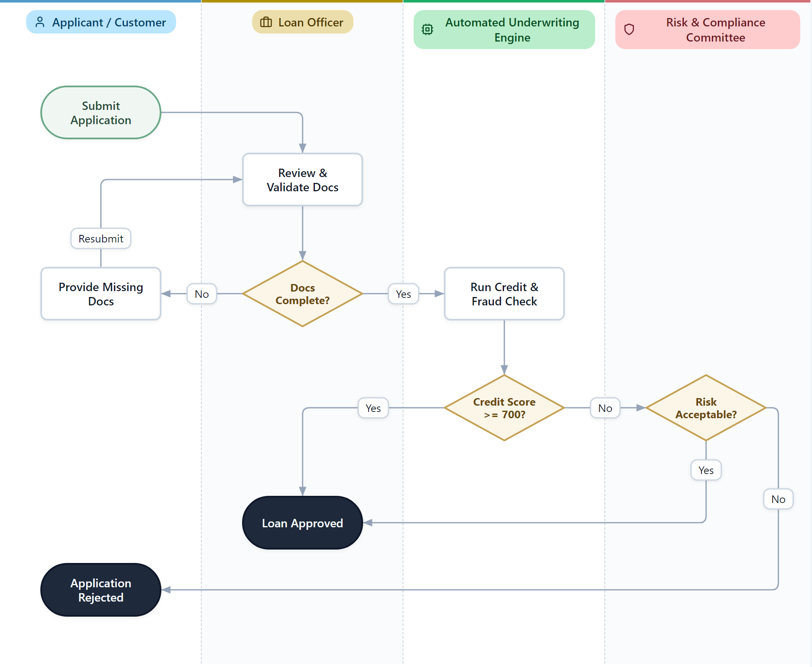
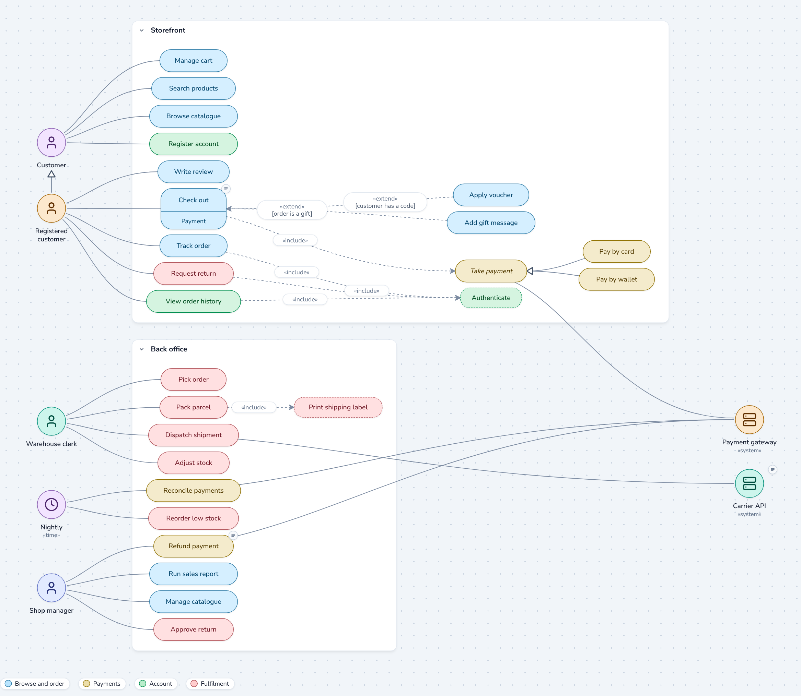

# Ultimate Diagram Skill

**Ask your AI for a diagram. Get one you can actually edit.**

Describe a process, and your AI assistant hands back a single HTML file. Open it in any browser, drag things around, fix a label, and save. No account, no app to install, and it works offline.

**[Try a flowchart live](https://claude.ai/artifact/4GXf3ufVkqEMR9BNy7UuWE)** · **[sequence diagram](https://claude.ai/artifact/5GAHnbS8tb9bxKxAi4JDYz)** · **[ER diagram](https://claude.ai/artifact/39Vy8dhSEdN4MjqVe1qQEv)** · **[use case diagram](https://claude.ai/artifact/XHQv3cFEPjBJitmvAq8QwE)**: each opens in your browser, no install. More below under [Diagram types](#diagram-types).

## What you get

- ⚡ **Faster and cheaper.** The AI writes a short description of your diagram (about 5.6 KB for the example above), not thousands of lines of drawing code. You wait less, spend fewer tokens, and long diagrams don't eat your usage limit.
- ✏️ **Fix it yourself, no re-prompting.** Wrong label? Step in the wrong lane? Drag it, retype it, delete it. Undo and redo work. Press **Save** and the changes are stored in the same file.
- 🧹 **Always tidy.** Add, move or delete a step and the diagram re-arranges itself and re-routes the arrows (switch **Auto-Tidy** off to place steps by hand). **Tidy** does the same on demand.
- 💬 **Your edits and the AI's edits combine.** Tweak the diagram by hand, then tell the AI "add an approval step after review". It picks up from your edited version instead of starting over and undoing your work.
- ↔️ ↕️ **Wide or tall.** Flip between left-to-right and top-to-bottom with one button. Pick whichever fits your page or slide.
- 🔤 **Long arrows stay readable.** An arrow that would cross half the diagram becomes a pair of lettered circles (A → A). Hover a circle, or the step it's attached to, to see where the flow continues; click it to jump there.
- ✅ **Arrives clean.** The AI checks its own result for overlapping boxes and unreadable labels before showing you.
- 🎨 **Your brand.** Give the AI a website address or a brand guide and every diagram uses your colours, font, corner style and icon weight. Text stays readable: the colours are checked against WCAG 2.2 AA contrast in light and dark mode, and any that fall short are nudged until they pass.
- 📦 **Just a file.** Email it, put it in a repo, attach it to a ticket, or open it offline.

## How it compares

We gave AI assistants the same jobs in three formats: this skill, Mermaid, and draw.io.

### Making a diagram

Same prompt for a large process (7 lanes, about 50 to 60 steps, 5 possible outcomes), run in two AI assistants: Antigravity and GitHub Copilot.

| | **Ultimate Diagram** | **Mermaid** | **draw.io** |
|---|:---:|:---:|:---:|
| Time to finish | **3.4 to 4 min** | 4.9 to 5.5 min | 6.9 to 7.6 min |
| Actions the AI took | **8 to 11** | 12 to 32 | 26 to 30 |
| Tokens used (Copilot) | **0.69 million** | 2.32 million | 2.54 million |
| Cost (Copilot, estimated) | **$0.09** | $0.29 | $0.34 |
| Every step and outcome included | ✅ | ✅ | ✅ |
| Layout checked for overlaps | ✅ every time, with a screenshot | ⚠️ only if the AI decides to | ⚠️ boxes only, arrows unchecked |

**In plain English:** this skill finished 19% to 38% sooner than Mermaid and in about half the time of draw.io. In Copilot it used 70% fewer tokens than Mermaid and 73% fewer than draw.io, so it cost about a third as much as Mermaid and a quarter as much as draw.io. The reason: the AI only writes the steps and arrows, and a script draws the picture. With draw.io the AI has to work out the position of every box and arrow itself.

### Reading a diagram back

We asked an AI (Claude Haiku) to summarize 4 saved diagrams, from 9 to 41 steps each.

| | **Ultimate Diagram** | **Mermaid** | **draw.io** |
|---|:---:|:---:|:---:|
| Time to answer | **16 s** | 30 s | 40 s |
| Tokens used | **42,800** | 44,300 | 53,300 |
| Correct answers | 4 / 4 | 4 / 4 | 4 / 4 |

**In plain English:** every format gave correct answers. With this skill installed, the AI answered in about half the time it took for Mermaid and in 60% less time than for draw.io. It used about as many tokens as Mermaid (3% fewer) and 20% fewer than draw.io. Without the skill, the AI still answers correctly but takes about 38 s and 54,000 tokens, because it reads part of the built-in editor first.

### Features

| | **Ultimate Diagram** | **Mermaid** | **draw.io** |
|---|:---:|:---:|:---:|
| Edit by dragging and typing | ✅ | ❌ edit the code or ask the AI | ✅ |
| Everything the AI wrote can be changed by hand | ✅ lane colours, legends, activation bars and more (a step's shape is still set by the AI) | ❌ edit the code | ✅ |
| Opens with nothing to install | ✅ any browser | ✅ shown by GitHub, GitLab, VS Code | ⚠️ needs the draw.io app or website |
| Real swimlanes | ✅ | ❌ coloured groups only | ✅ |
| Switch wide / tall in one click | ✅ | ⚠️ edit the code | ❌ |
| Re-tidies itself after edits | ✅ | ✅ always automatic, but no dragging | ⚠️ limited |
| Shows inside Markdown docs | ❌ | ✅ | ❌ |
| File size | ⚠️ about 330 to 530 KB (editor built in) | ✅ 10 to 26 KB | ✅ 39 to 56 KB |
| Huge shape and icon library | ❌ | ❌ | ✅ |

**Pick Mermaid** for small diagrams that live inside Markdown docs.

**Pick draw.io** for free-form drawing with lots of shapes.

**Pick this** for clear, editable process diagrams from your AI, made fast and cheaply.

These are single runs per assistant (November 2026), not averages: treat the percentages as a rough guide, and expect different numbers with a different diagram or AI.

## Diagram types

| Type | Status |
|---|---|
| **Flowchart**: swimlanes, decisions, loops, wide or tall; classic shapes (document, database, input/output, subprocess, delay) and lettered connectors for long arrows; copy as Mermaid | ✅ Available |
| **Sequence**: who talks to whom over time, with optional, alternative and loop sections; copy as Mermaid | ✅ Available |
| **ERD**: database tables, columns, keys and crow's-foot relationships, tables colour-coded by domain, laid out as a graph with smooth curves; collapse tables, add notes, copy as Mermaid | ✅ Available |
| **Use case**: UML actors, use cases and system boundaries with include, extend and generalization; use cases coloured by feature area, actors colour-coded, soft curved lines; hover to see what connects to what, search by requirement id, collapse a system | ✅ Available |

### Flowchart

[](https://claude.ai/artifact/4GXf3ufVkqEMR9BNy7UuWE)

▶ [Try the flowchart](https://claude.ai/artifact/4GXf3ufVkqEMR9BNy7UuWE): click, drag and edit it in your browser. The same diagram flips to a tall layout with one button:

[](https://claude.ai/artifact/4GXf3ufVkqEMR9BNy7UuWE)

### Sequence diagram

[](https://claude.ai/artifact/5GAHnbS8tb9bxKxAi4JDYz)

▶ [Try the sequence diagram](https://claude.ai/artifact/5GAHnbS8tb9bxKxAi4JDYz)

### ER diagram

[](https://claude.ai/artifact/39Vy8dhSEdN4MjqVe1qQEv)

▶ [Try the ER diagram](https://claude.ai/artifact/39Vy8dhSEdN4MjqVe1qQEv)

### Use case diagram

[](https://claude.ai/artifact/XHQv3cFEPjBJitmvAq8QwE)

Who wants what from which system: actors on the left and right, their goals inside each system's box, «include» and «extend» between goals. Hover an actor or a use case to grey out everything it is not directly connected to; type a requirement id such as `FR-4` to find the use case that covers it.

▶ [Try the use case diagram](https://claude.ai/artifact/XHQv3cFEPjBJitmvAq8QwE)

Each demo is a claude.ai Artifact; **Download .html** inside it saves your edits. The same samples as files you can open offline: [flowchart](dev/samples/example-flowchart.html), [sequence](dev/samples/example-sequence.html), [ERD](dev/samples/example-erd.html), [use case](dev/samples/example-usecase.html).

## Coming next

| | Planned |
|---|---|
| 🔜 | **BPMN**: pools, lanes, events, gateways |
| 🔜 | **State diagram**: states and transitions |
| 💡 | Class and component diagrams |
| 💡 | Gantt / timeline |
| 💡 | Mind map / org chart |
| 💡 | Export to SVG, PNG, PDF; import from Mermaid; export to draw.io and BPMN |

🔜 next, 💡 later. Order may change.

## Get started

1. Install the skill into your AI assistant:
   ```shell
   npx khanhchungoc/ultimate-diagraming-skill
   ```
   Works with Claude Code, GitHub Copilot, OpenAI Codex, Gemini CLI, Antigravity and Kiro. By default it installs into each one's skills folder under your home directory (a copy when run through `npx`). Add `--runtime claude` to pick one assistant, or `--project` to install into the current project only.
2. Ask: *"Draw a swimlane flowchart of our loan approval process."*
3. Open the HTML file it creates and edit.

## Diagrams as claude.ai Artifacts

In Claude Code the diagram can be published as a private claude.ai Artifact instead of an HTML file. Claude asks once which you want (a saved default skips the question). Inside the artifact you edit as usual and press **Save**: that publishes a new version of the same artifact, so the next change you ask Claude for starts from your saved edits. Share the link from claude.ai; people without edit access see the diagram and can **Download .html** instead of saving. To make the link public, use the artifact's Share menu; claude.ai reviews the page first, and `python dev/check_artifact_shape.py` catches known causes of a rejection (for example `data:` inside a tooltip) before you publish.

Set the default when installing, or any time later:

```shell
npx khanhchungoc/ultimate-diagraming-skill --runtime claude --claude-output artifact   # or: file, ask
```

It is stored in `~/.claude/ultimate-diagram.json` (or `<project>/.claude/ultimate-diagram.json` with `--project`). Other assistants always write the HTML file. Details: [plan](dev/plans/plan-artifact-output.md).

## Ask your AI about a diagram

Hand any diagram file to an AI assistant and ask "summarize this flow" or "who approves the refund?". The diagram is stored as a short block of data at the top of the file, and the file's second line tells the assistant exactly which lines to read, so it skips the editor code below. With this skill installed, the assistant pulls out just that data in one step.

## Requirements

Needs `Python 3.9+` and `Chrome`, `Chromium` or `Edge` (used to lay out and check every diagram). `Node 18+` is optional and makes layout faster. The installer checks all of these and tells you what is missing.

## Credits

The icons in the editor and on the swimlane headers are [Lucide](https://lucide.dev) icons (ISC licence, Copyright (c) Lucide Icons and Contributors), or are redrawn from Lucide designs; some Lucide icons derive from [Feather](https://feathericons.com) (MIT licence, Copyright (c) Cole Bemis). The diagram-type icons, the flowchart shape tiles and a few others were drawn for this skill. The icon registry is `assets/icons/default.json` and the full licence notices are in `assets/icons/LICENSE`.
