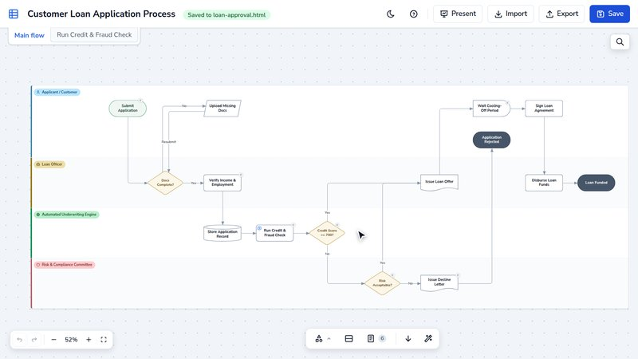
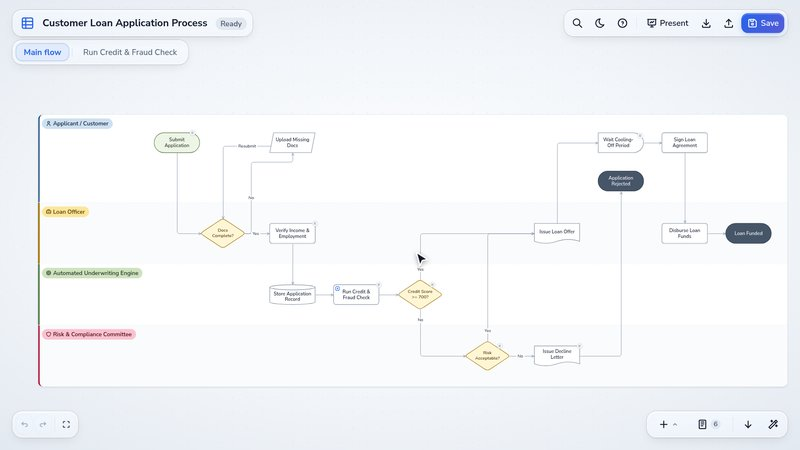
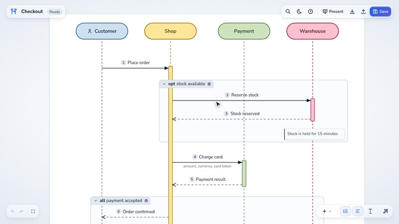
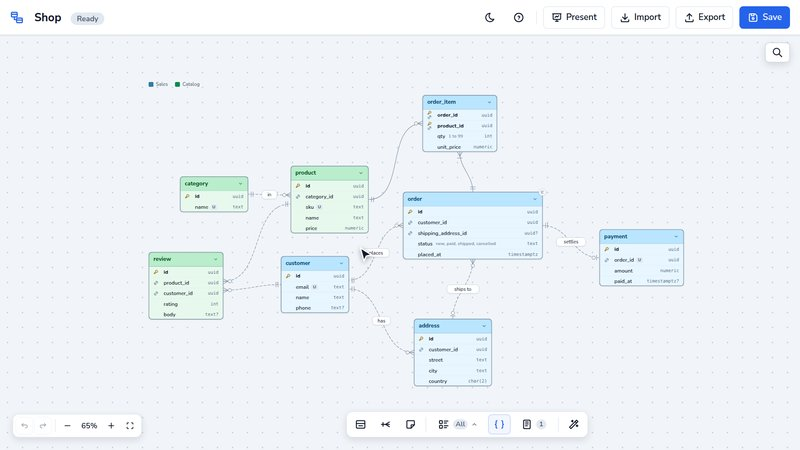
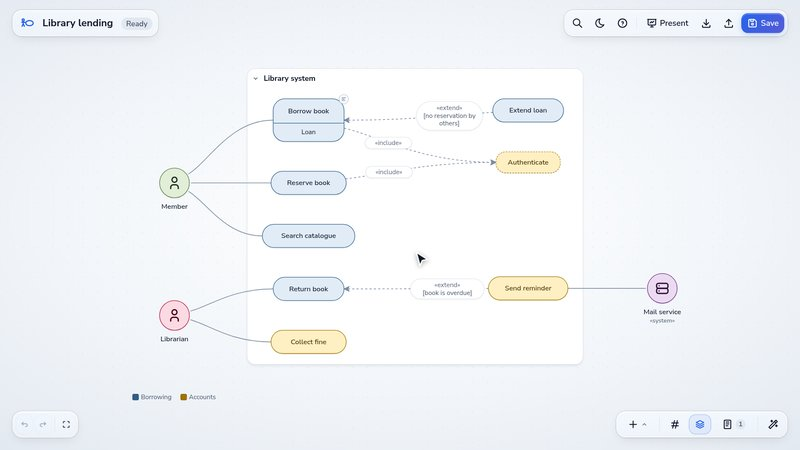
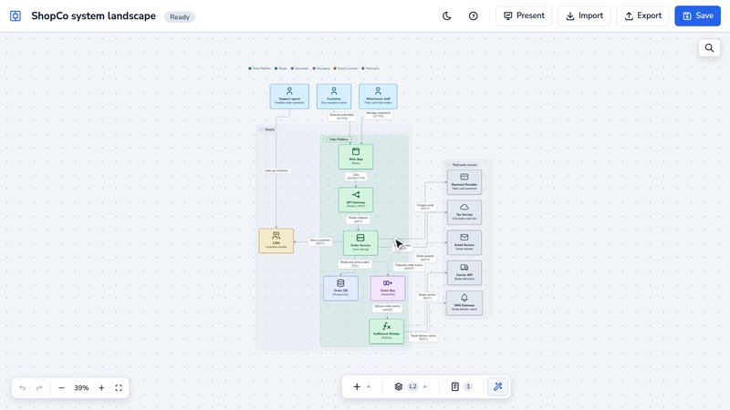

# Ultimate Diagram Skill

[](https://github.com/khanhchungoc/ultimate-diagraming-skill/releases/latest)
[](https://www.npmjs.com/package/ultimate-diagram)
[](https://github.com/khanhchungoc/ultimate-diagraming-skill/releases)

**Ask your AI for a diagram. Get one you can actually edit.**

Describe a process, and your AI agent hands back a single HTML file. Open it in any browser, drag things around, fix a label, and save. No account, no app to install, and it works offline.

<a href="https://khanhchungoc.github.io/ultimate-diagraming-skill/examples/flowchart/"><picture><source srcset="docs/img/demo.webp" type="image/webp"></picture></a>

### 👉 **[Try the playground, no install](https://khanhchungoc.github.io/ultimate-diagraming-skill/)** 👈

## Contents

- [What you get](#what-you-get)
- [Diagram types](#diagram-types)
- [Examples](#examples)
- [Get started](#get-started)
- [Use your brand](#use-your-brand)
- [How it compares to Mermaid and draw.io](#how-it-compares-to-mermaid-and-drawio)
- [Build your own skills](#build-your-own-skills)
- [Update check](#update-check)

## What you get

- ✏️ **Fix it yourself, no re-prompting.** Drag, retype, or delete anything. Undo, redo, and **Ctrl+F** search work out of the box.
- 💬 **Your edits and the AI's edits combine.** Edit by hand, then ask the AI to change or extend the diagram — it builds on your saved version (in-place in [claude.ai Artifacts](docs/artifacts.md) or directly in your saved HTML file).
- 🧹 **Always tidy.** Diagrams lay themselves out cleanly — no overlaps or unreadable labels. Edit anything and it stays tidy, or click **Tidy** to re-layout and re-route arrows in one click.
- ⚡ **Fast and cheap.** The AI writes compact Mermaid instead of thousands of lines of drawing code — fast to generate and cheap on tokens.
- 📦 **Just a file.** Share or open it offline anywhere. Optionally [use your brand](#use-your-brand) (colours, font, corners, contrast-checked).

## Diagram types

| Type | Shows | Status |
|---|---|---|
| **Flowchart** | Process steps and decisions in swimlanes | ✅ |
| **Sequence** | Who talks to whom, over time | ✅ |
| **ERD** | Database tables, keys and relationships | ✅ |
| **Use case** | Actors, goals and system boundaries | ✅ |
| **C4** | System landscape: people, systems and containers (levels 1–2) | ✅ |
| **Gantt** | High-level roadmap timeline: calendar dates, Day–Year zoom, nested subtasks, drag & multi-select, FS/SS dependencies, milestones, notes, Today line, local holidays | ✅ |
| **BPMN** | Pools, lanes, events and gateways | 🔜 |
| **State machine** | States and transitions | 🔜 |
| **Mind map** | Ideas branching from a central topic | 🕐  |
| **Gantt chart** | Tasks on a timeline | 🕐 |

*Order may change.*

## Examples

| Diagram | Demo |
|---|---|
| Flowchart<br>[Try live](https://khanhchungoc.github.io/ultimate-diagraming-skill/examples/flowchart/) | <a href="https://khanhchungoc.github.io/ultimate-diagraming-skill/examples/flowchart/"><picture><source srcset="docs/img/demo-flowchart.webp" type="image/webp"></picture></a> |
| Sequence diagram<br>[Try live](https://khanhchungoc.github.io/ultimate-diagraming-skill/examples/sequence/) | <a href="https://khanhchungoc.github.io/ultimate-diagraming-skill/examples/sequence/"><picture><source srcset="docs/img/demo-sequence.webp" type="image/webp"></picture></a> |
| ER diagram<br>[Try live](https://khanhchungoc.github.io/ultimate-diagraming-skill/examples/erd/) | <a href="https://khanhchungoc.github.io/ultimate-diagraming-skill/examples/erd/"><picture><source srcset="docs/img/demo-erd.webp" type="image/webp"></picture></a> |
| Use case diagram<br>[Try live](https://khanhchungoc.github.io/ultimate-diagraming-skill/examples/usecase/) | <a href="https://khanhchungoc.github.io/ultimate-diagraming-skill/examples/usecase/"><picture><source srcset="docs/img/demo-usecase.webp" type="image/webp"></picture></a> |
| C4 diagram<br>[Try live](https://khanhchungoc.github.io/ultimate-diagraming-skill/examples/c4/) | <a href="https://khanhchungoc.github.io/ultimate-diagraming-skill/examples/c4/"><picture><source srcset="docs/img/demo-c4.webp" type="image/webp"></picture></a> |

## Get started

### Option A: ask your AI agent

```text
Install the ultimate-diagram skill from https://github.com/khanhchungoc/ultimate-diagraming-skill (pick the best install method from the README for this environment).
```

### Option B: one command (terminal)

Run in your terminal (requires **Node.js 18+**).

All your projects (global):

```shell
npx ultimate-diagram@latest
```

Current project only:

```shell
npx ultimate-diagram@latest -p
```

Target a single runtime with `-r <name>` (e.g. `npx ultimate-diagram@latest -r antigravity`), or pass `--no-hooks` to skip registering `SessionStart` update-check hooks.

### Option C: download (no terminal needed)

Open the [latest release](https://github.com/khanhchungoc/ultimate-diagraming-skill/releases/latest) and download `ultimate-diagram-vX.Y.Z.zip` (under **Assets**).

**On claude.ai (web or desktop):**

Keep it zipped. Turn on **Code execution and file creation** in **Settings > Capabilities**, then go to **Customize > Skills > `+` > Create skill > Upload a skill**, upload the `.zip`, and turn it on.

**On local agents:**

1. Unzip it. You get one folder named `ultimate-diagram`.
2. Move that folder into your agent's `skills` folder (create it if it is missing):

   | Agent | Skills folder (for all your projects) |
   |---|---|
   | Antigravity | `.gemini/config/skills` in your home folder (`.agents/skills` per project) |
   | Claude Code | `.claude/skills` in your home folder |
   | GitHub Copilot | `.copilot/skills` in your home folder (`.github/skills` per project) |
   | OpenAI Codex | `.agents/skills` in your home folder |
   | Gemini CLI | `.gemini/skills` in your home folder |
   | Kiro | `.kiro/skills` in your home folder |

   Folders starting with a dot are hidden. Mac: in Finder press `Cmd` + `Shift` + `.` to show them. Windows: your home folder is `C:\Users\<your name>`; turn on **View > Show > Hidden items**. For one project only, use the same folder inside that project instead.
3. Restart your agent.

### Requirements

Needs **Python 3.9+** and **Node.js 18+** or **Chrome / Chromium / Edge** (if missing, your agent flags it on the first diagram).

### Then

1. Ask your agent: *"Draw a swimlane flowchart of our loan approval process."*
2. It saves an HTML file in your project folder and tells you the path. Open it in your browser and edit.
3. Press **Save** in the diagram to keep your edits.

## Use your brand

<details>
<summary>Show how</summary>

Give the AI a website address or a brand guide (PDF, image or CSS file) and ask for diagrams in that look. It extracts colours, font, corner style and icon weight, checks contrast in light and dark mode, and shows you the report and three preview images. Nothing is kept until you accept it.

Text stays readable: the colours are checked against WCAG 2.2 AA contrast in light and dark mode, and any that fall short are nudged until they pass.

Example prompts:

- *"Use the brand from https://example.com and draw a swimlane flowchart of our loan approval process."*
- *"Here is our brand guide (brand.pdf). Make diagrams in this style, then draw a sequence diagram of the login flow."*

Once accepted, the theme is saved as `theme.json` in your skill folder (so user-level installs apply across all your projects without adding files to your project repo, and updates keep it). Every later diagram uses it; diagrams you already saved pick it up the next time they are re-laid out. You can ask the AI anytime to tweak your theme or reset back to the default theme (or place a `.ultimate-diagram/theme.json` in a specific project to override it there).

For contributors: [references/theme.md](references/theme.md).

</details>

## How it compares to Mermaid and draw.io

- ⚡ **This**: clear, editable process diagrams from your AI.
- 🧩 **Mermaid**: small diagrams inside Markdown docs.
- 🎨 **draw.io**: free-form drawing, huge shape library.

<details>
<summary>Show the comparison</summary>

### Features

| | **This** | **Mermaid** | **draw.io** |
|---|:---:|:---:|:---:|
| Edit by drag and type | ✅ | ❌ code | ✅ |
| Hand-edit everything the AI wrote | ✅ | ❌ | ✅ |
| Nothing to install | ✅ | ✅ | ⚠️ app or site |
| Real swimlanes | ✅ | ❌ | ✅ |
| Re-layout (wide ↔ tall, 1 click) | ✅ | ⚠️ code | ❌ |
| Auto-layout / re-layout after edits | ✅ | ⚠️ no drag | ⚠️ limited |
| In Markdown docs | ❌ | ✅ | ❌ |
| Export PNG / SVG / PDF | ✅ PNG, SVG | ✅ | ✅ |
| File size | ⚠️ 330-530 KB | ✅ 10-26 KB | ✅ 39-56 KB |
| Shape / icon library | ✅ Devicon + custom packs | ❌ | ✅ |

</details>

## Build your own skills

Liked this skill? Make your own with [**craft-agent-skill**](https://github.com/khanhchungoc/craft-agent-skill) — creates, updates and audits agents and skills for Copilot, Claude Code, Codex, Gemini and Kiro.

## Update check

`scripts/version_check.py` checks GitHub Releases asynchronously in the background (via `SessionStart` hooks on Claude Code and Gemini CLI, and automatically during `layout_engine.py` runs across all 6 runtimes), cached locally for 24 hours. It sends no user data and never updates without your confirmation. Opt out anytime by setting `ULTIMATE_DIAGRAM_NO_UPDATE_CHECK=1` or installing with `--no-hooks`.
