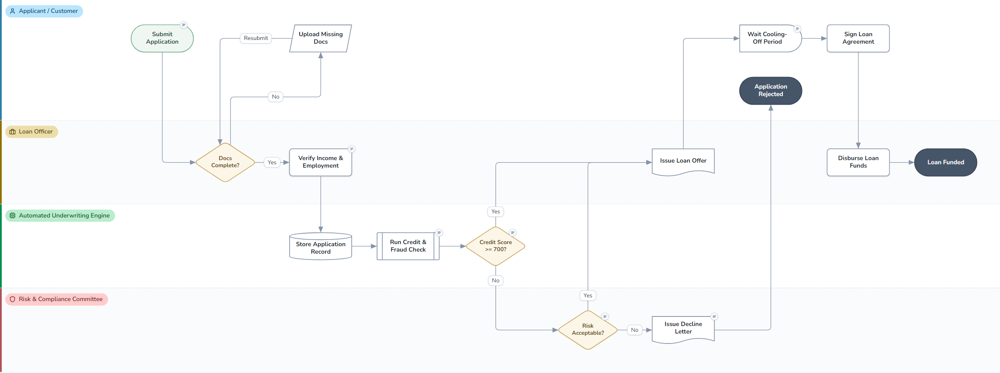
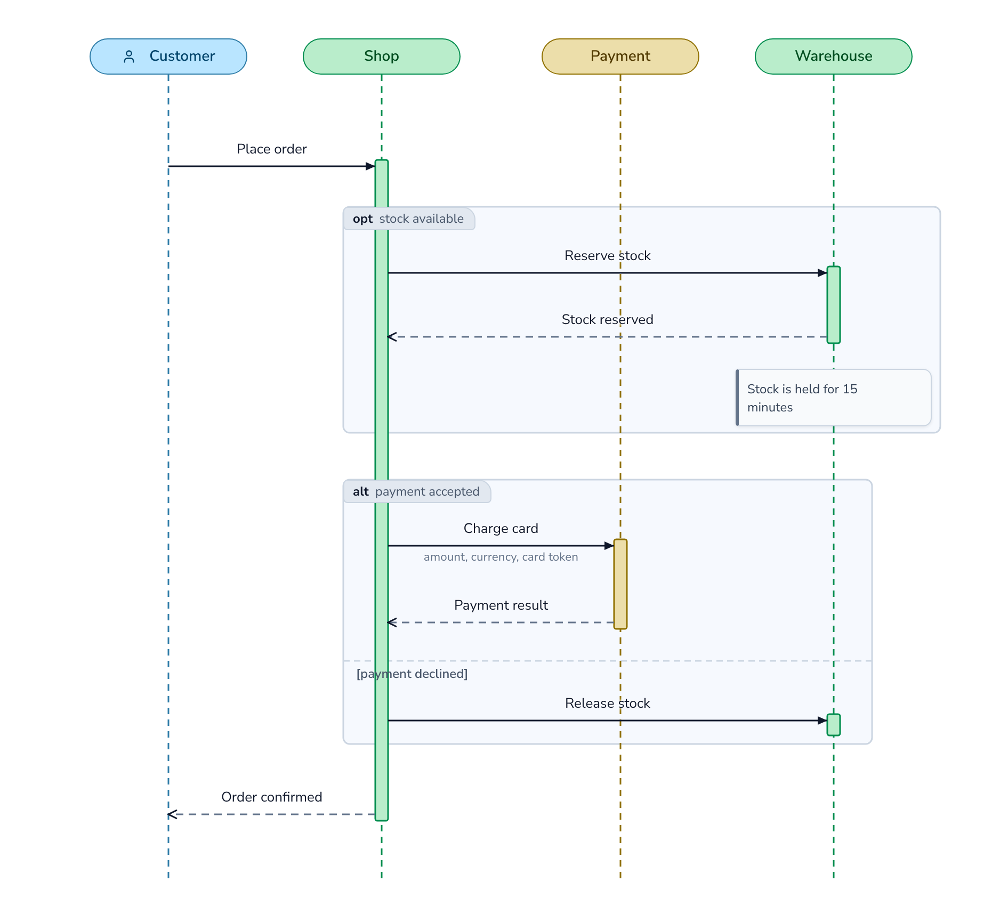
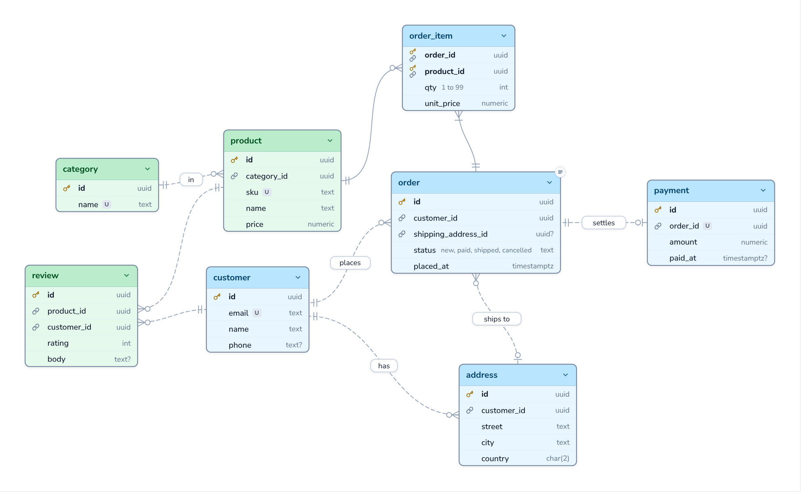

# Ultimate Diagram Skill

**Ask your AI for a diagram. Get one you can actually edit.**

Describe a process, and your AI agent hands back a single HTML file. Open it in any browser, drag things around, fix a label, and save. No account, no app to install, and it works offline.

[](https://claude.ai/artifact/4GXf3ufVkqEMR9BNy7UuWE)

**Try it live, no install:** [flowchart](https://claude.ai/artifact/4GXf3ufVkqEMR9BNy7UuWE) · [sequence](https://claude.ai/artifact/5GAHnbS8tb9bxKxAi4JDYz) · [entity relationship](https://claude.ai/artifact/39Vy8dhSEdN4MjqVe1qQEv) · [use case](https://claude.ai/artifact/DyGtj4nxA7nvkmjdfcFddG)

## Contents

- [What you get](#what-you-get)
- [Diagram types](#diagram-types)
- [Offline samples](#offline-samples)
- [Get started](#get-started)
- [Use your brand](#use-your-brand)
- [How it compares to Mermaid and draw.io](#how-it-compares-to-mermaid-and-drawio)
- [Build your own skills](#build-your-own-skills)
- [Credits and licence](#credits-and-licence)

## What you get

- ✏️ **Fix it yourself, no re-prompting.** Wrong label? Step in the wrong lane? Drag it, retype it, delete it. Undo and redo work. **Ctrl+F** searches the diagram's text.
- 💬 **Your edits and the AI's edits combine.** Tweak the diagram by hand, then tell the AI "add an approval step after review". It picks up from your edited version instead of starting over. This works best as a [claude.ai Artifact](docs/artifacts.md), where **Save** stores your edits straight into the artifact. With a plain HTML file, **Save** works like Save As (see [Save vs Export](#save-vs-export)), so you point the AI at the saved file.
- 🧹 **Always tidy.** The AI checks its own result for overlapping boxes and unreadable labels before showing you. After that, add, move or delete a step and the diagram re-arranges itself and re-routes the arrows. Flip between wide and tall with one button. Long arrows become lettered circles (A → A): hover to see where the flow continues, click to jump there.
- ⚡ **Fast and cheap.** The AI writes a short description instead of thousands of lines of drawing code, so you wait less and spend fewer tokens ([numbers](#how-it-compares-to-mermaid-and-drawio)).
- 📦 **Just a file.** Email it, put it in a repo, attach it to a ticket, or open it offline. Optionally [use your brand](#use-your-brand): colours, font and corners, contrast-checked.

## Diagram types

| Type | Shows | Status |
|---|---|---|
| **Flowchart** | Process steps and decisions in swimlanes | ✅ |
| **Sequence** | Who talks to whom, over time | ✅ |
| **ERD** | Database tables, keys and relationships | ✅ |
| **Use case** | Actors, goals and system boundaries | ✅ |
| **BPMN** | Pools, lanes, events and gateways | 🔜 |
| **State machine** | States and transitions | 🔜 |
| **C4** | System context, containers and components | 🕐 |
| **Mind map** | Ideas branching from a central topic | 🕐  |
| **Gantt chart** | Tasks on a timeline | 🕐 |

*Order may change.*

### Flowchart

*"Draw a swimlane flowchart of our loan approval process."*

[](https://claude.ai/artifact/4GXf3ufVkqEMR9BNy7UuWE)

▶ [Try the flowchart](https://claude.ai/artifact/4GXf3ufVkqEMR9BNy7UuWE)

### Sequence diagram

*"Draw a sequence diagram of the login flow between the app, API gateway and auth service."*

[](https://claude.ai/artifact/5GAHnbS8tb9bxKxAi4JDYz)

▶ [Try the sequence diagram](https://claude.ai/artifact/5GAHnbS8tb9bxKxAi4JDYz)

### ER diagram

*"Draw an ER diagram for an online shop: customers, orders, products and payments."*

[](https://claude.ai/artifact/39Vy8dhSEdN4MjqVe1qQEv)

▶ [Try the ER diagram](https://claude.ai/artifact/39Vy8dhSEdN4MjqVe1qQEv)

### Use case diagram

*"Draw a use case diagram for our booking system, with requirement ids."*

[](https://claude.ai/artifact/DyGtj4nxA7nvkmjdfcFddG)

Search by requirement id (such as `FR-4`) to find the use case that covers it.

▶ [Try the use case diagram](https://claude.ai/artifact/DyGtj4nxA7nvkmjdfcFddG)

## Offline samples

The same demos as HTML files you can open in your browser without a connection: [flowchart](dev/samples/example-flowchart.html), [sequence](dev/samples/example-sequence.html), [ERD](dev/samples/example-erd.html), [use case](dev/samples/example-usecase.html).

## Get started

### Before you start

You need Python 3.9+ and Chrome, Chromium or Edge (used to lay out and check every diagram). Node.js 18+ is optional: if it is installed, layout runs a bit faster. The installer checks all of these and tells you what is missing. If something is, ask your agent to install it for you.

### Option A: one command

If you have Node.js, run one of these in a terminal. It shows the version it installs.

For all your projects:

```shell
npx khanhchungoc/ultimate-diagraming-skill
```

For the current project only, run it inside the project folder:

```shell
npx khanhchungoc/ultimate-diagraming-skill --project
```

Both install into every supported agent. Add `--runtime claude` to pick one.

Or ask your AI agent to install it for you: *"Install the ultimate-diagram skill with `npx khanhchungoc/ultimate-diagraming-skill`."*

### Option B: download (no terminal needed)

1. Open the [latest release](https://github.com/khanhchungoc/ultimate-diagraming-skill/releases/latest) and download `ultimate-diagram-vX.Y.Z.zip` (under **Assets**).
2. Unzip it. You get one folder named `ultimate-diagram`.
3. Move that folder into your agent's `skills` folder (create it if it is missing):

   | Agent | Skills folder (for all your projects) |
   |---|---|
   | Claude Code | `.claude/skills` in your home folder |
   | GitHub Copilot | `.copilot/skills` in your home folder |
   | OpenAI Codex | `.agents/skills` in your home folder |
   | Gemini CLI | `.gemini/skills` in your home folder |
   | Kiro | `.kiro/skills` in your home folder |

   Folders starting with a dot are hidden. Mac: in Finder press `Cmd` + `Shift` + `.` to show them. Windows: your home folder is `C:\Users\<your name>`; turn on **View > Show > Hidden items**. For one project only, use the same folder inside that project instead.
4. Restart your agent.

### Then

1. Ask your agent: *"Draw a swimlane flowchart of our loan approval process."*
2. It saves an HTML file in your project folder and tells you the path. Open it in your browser and edit.
3. Press **Save** in the diagram to keep your edits.

### Save vs Export

- **Opened as a claude.ai Artifact** (Claude Code with Artifact output): **Save** stores your edits directly in the artifact as a new version, so your agent's next change starts from them. If you only have view access (for example the live demos), use **Export > HTML file (editable)** to get your own editable copy as a standalone HTML file. See [Artifacts](docs/artifacts.md).
- **Opened as a regular HTML file:** the browser cannot write into the file you opened, so the first **Save** works like Save As. In Chrome and Edge, Save first shows where the file you opened lives, with a button that copies that path: paste it into the Save window (Windows: the File name box; macOS: press ⌘⇧G; Linux: press Ctrl+L) to save over the original. After that, Save writes straight to the file; when you reopen it, the browser asks once per session to allow editing. Firefox and Safari save a copy to your downloads folder instead. To have your agent continue from your edits, tell it which saved file to use.

## Use your brand

<details>
<summary>Show how</summary>

Give the AI a website address or a brand guide (PDF, image or CSS file) and ask for diagrams in that look. It extracts colours, font, corner style and icon weight, checks contrast in light and dark mode, and shows you the report and three preview images. Nothing is kept until you accept it.

Text stays readable: the colours are checked against WCAG 2.2 AA contrast in light and dark mode, and any that fall short are nudged until they pass.

Example prompts:

- *"Use the brand from https://example.com and draw a swimlane flowchart of our loan approval process."*
- *"Here is our brand guide (brand.pdf). Make diagrams in this style, then draw a sequence diagram of the login flow."*

Once accepted, the theme is saved as `.ultimate-diagram/theme.json` in your project and every later diagram there uses it; diagrams you already saved pick it up the next time they are re-laid out. To switch back, delete that file.

For contributors: [references/theme.md](references/theme.md).

</details>

## How it compares to Mermaid and draw.io

- ⚡ **This**: clear, editable process diagrams from your AI.
- 🧩 **Mermaid**: small diagrams inside Markdown docs.
- 🎨 **draw.io**: free-form drawing, huge shape library.

<details>
<summary>Show the comparison</summary>

### Features

| | **This** | **Mermaid** | **draw.io** |
|---|:---:|:---:|:---:|
| Edit by drag and type | ✅ | ❌ code | ✅ |
| Hand-edit everything the AI wrote | ✅ | ❌ | ✅ |
| Nothing to install | ✅ | ✅ | ⚠️ app or site |
| Real swimlanes | ✅ | ❌ | ✅ |
| Wide ↔ tall, 1 click | ✅ | ⚠️ code | ❌ |
| Re-tidies after edits | ✅ | ⚠️ no drag | ⚠️ limited |
| In Markdown docs | ❌ | ✅ | ❌ |
| Diagram types | 4 | many | many |
| Export PNG / SVG / PDF | ❌ planned | ✅ | ✅ |
| File size | ⚠️ 330-530 KB | ✅ 10-26 KB | ✅ 39-56 KB |
| Shape / icon library | ❌ | ❌ | ✅ |

</details>

## Build your own skills

> ### 🛠️ [craft-agent-skill](https://github.com/khanhchungoc/craft-agent-skill)
>
> Liked this skill? Make your own. **craft-agent-skill** creates, updates and audits agents and skills for Copilot, Claude Code, Codex, Gemini and Kiro.
>
> **[Get craft-agent-skill →](https://github.com/khanhchungoc/craft-agent-skill)**
