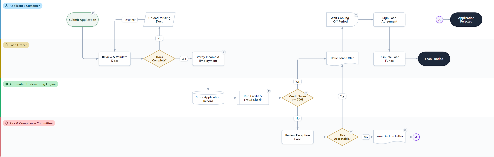
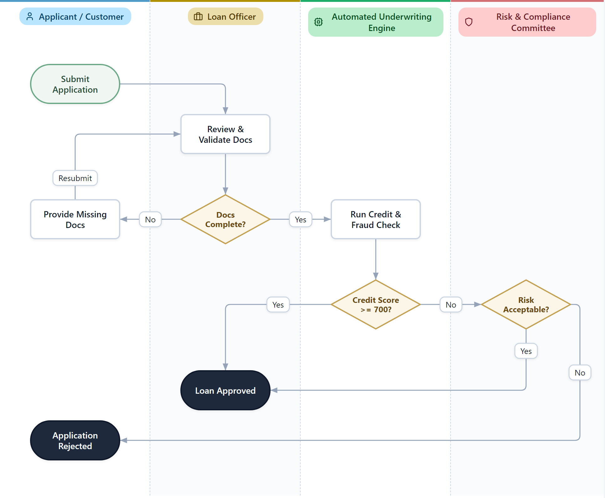
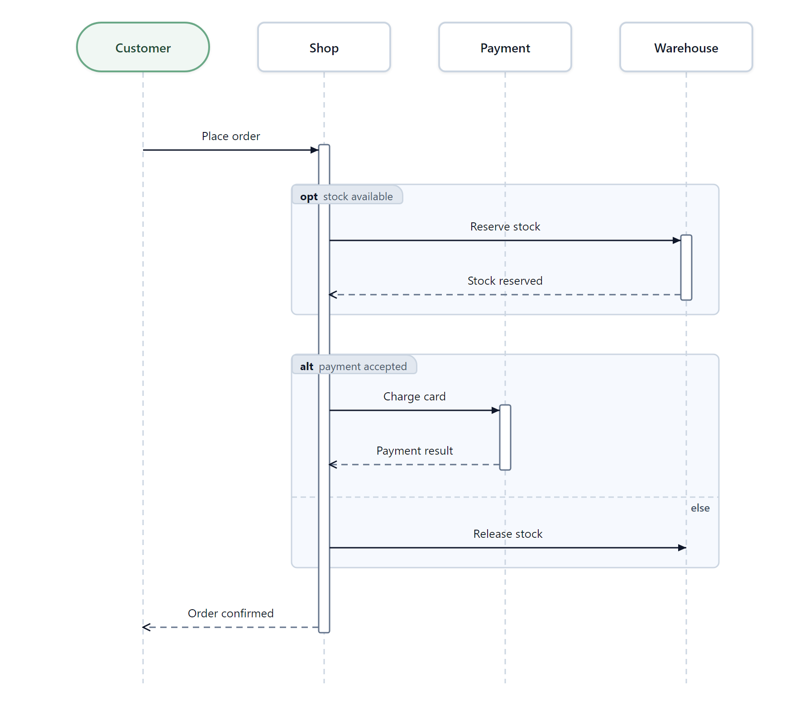

# Ultimate Diagram Skill

**Ask your AI for a diagram. Get one you can actually edit.**

Describe a process, and your AI assistant hands back a single HTML file. Open it in any browser, drag things around, fix a label, and save. No account, no app to install, no internet needed.



## What you get

- ⚡ **Faster and cheaper.** The AI writes a short description of your diagram (about 2.8 KB for the example above), not thousands of lines of drawing code. You wait less, spend fewer tokens, and long diagrams don't eat your usage limit.
- ✏️ **Fix it yourself, no re-prompting.** Wrong label? Step in the wrong lane? Drag it, retype it, delete it. Undo and redo work. Press **Save** and the changes are stored in the same file.
- 🧹 **Always tidy.** Add, move or delete a step and the diagram re-arranges itself and re-routes the arrows (switch **Auto-Tidy** off to place steps by hand). **Tidy** does the same on demand.
- 💬 **Your edits and the AI's edits combine.** Tweak the diagram by hand, then tell the AI "add an approval step after review". It picks up from your edited version instead of starting over and undoing your work.
- ↔️ ↕️ **Wide or tall.** Flip between left-to-right and top-to-bottom with one button. Pick whichever fits your page or slide.
- ✅ **Arrives clean.** The AI checks its own result for overlapping boxes and unreadable labels before showing you.
- 📦 **Just a file.** Email it, put it in a repo, attach it to a ticket, or open it offline.

### Same diagram, tall layout



## How it compares

| | **Ultimate Diagram** | **draw.io** | **bpmn.io** | **Other AI chart tools** (Mermaid, images) |
|---|:---:|:---:|:---:|:---:|
| AI generates it quickly and cheaply | ✅ | ❌ slow, verbose | ❌ slow, verbose | ⚠️ text ok, images heavy |
| You can edit the result by hand | ✅ | ✅ | ✅ | ❌ ask the AI again |
| Double-click the file and edit, nothing to install | ✅ | ⚠️ needs the app or website | ⚠️ needs a modeler or website | ❌ |
| Swimlanes built in | ✅ | ✅ | ✅ | ❌ |
| Switch wide / tall in one click | ✅ | ❌ | ❌ | ⚠️ regenerate |
| One-click tidy after editing | ✅ | ⚠️ limited | ❌ | ❌ |
| Shareable: one editable file, opens in any browser, no extra apps | ✅ | ❌ recipient needs draw.io | ❌ recipient needs a BPMN viewer | ⚠️ image or text only, not editable |
| Huge shape and icon library | ❌ | ✅ | ❌ | ❌ |
| Official BPMN for workflow engines | ❌ | ❌ | ✅ | ❌ |

**Pick draw.io** for free-form drawing with lots of shapes. **Pick bpmn.io** when you need standard BPMN that a workflow system will run. **Pick this** for clear, editable process diagrams from your AI, fast. Cost and speed comparisons are estimates and vary by diagram.

## Diagram types

| Type | Status |
|---|---|
| **Flowchart**: swimlanes, decisions, loops, wide or tall | ✅ Available |
| **Sequence**: who talks to whom over time, with optional, alternative and loop sections | ✅ Available |



## Coming next

| | Planned |
|---|---|
| 🔜 | **BPMN**: pools, lanes, events, gateways |
| 🔜 | **ERD**: database tables and relationships |
| 🔜 | **State diagram**: states and transitions |
| 💡 | Class and component diagrams |
| 💡 | Gantt / timeline |
| 💡 | Mind map / org chart |
| 💡 | Export to SVG, PNG, PDF; import from Mermaid; export to draw.io and BPMN |

🔜 next, 💡 later. Order may change.

## Get started

1. Install the skill into your AI assistant:
   ```shell
   npx khanhchungoc/ultimate-diagraming-skill
   ```
   Works with Claude Code, GitHub Copilot, OpenAI Codex, Gemini CLI, Antigravity and Kiro.
2. Ask: *"Draw a swimlane flowchart of our loan approval process."*
3. Open the HTML file it creates and edit.

### Viewing options

Add these to the end of the file's address in the browser:

| Add | Effect |
|---|---|
| `?present` | Read-only view with all editing controls hidden, for presenting or sharing |
| `?theme=dark` or `?theme=light` | Forces a theme. Without it, the toolbar toggle or your system setting decides |

## Requirements

Needs `Python 3.9+` and `Chrome`, `Chromium` or `Edge` (used to lay out and check every diagram). `Node 18+` is optional and makes layout faster. The installer checks all of these and tells you what is missing.

## Try it first

- [Loan application flowchart](dev/samples/example-flowchart.html)
- [Checkout sequence diagram](dev/samples/example-sequence.html)
