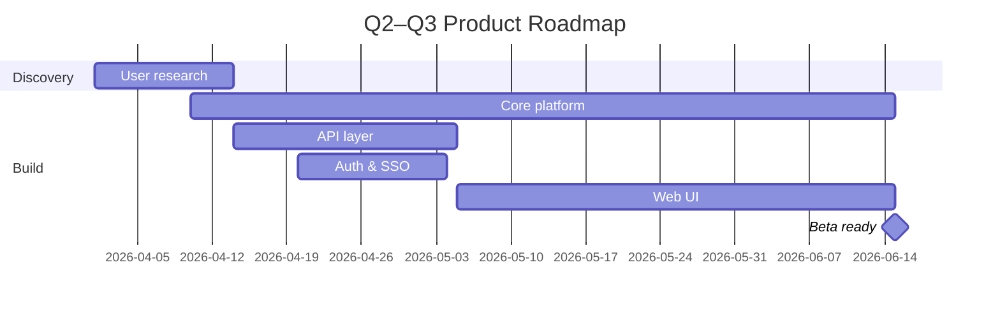

Status: Completed

# Plan: Gantt / roadmap timeline diagram type (`diagramType: "gantt"`)

Add an interactive Gantt chart for high-level roadmaps as the sixth diagram type, next to `flowchart`, `sequence`, `erd`, `usecase`, and `c4`. Users and AI agents author a roadmap in Mermaid `gantt` syntax (with lightweight `%% @...` comment extensions for features native Mermaid lacks). The tooling parses, validates, optionally enriches public holidays from the local timezone, lays out the timeline deterministically, and assembles one standalone, offline, editable HTML page (or claude.ai Artifact) using the shared shell.

---

## Goals

- **High-level roadmap clarity:** Clean task bars with names, 9-color palette + Color Key legend, and optional subtle progress fill (`%` complete).
- **Real calendar dates & time-scale zoom:** `YYYY-MM-DD` dates with 5 zoom presets — **Day**, **Week**, **Month**, **Quarter**, and **Year** — where zooming changes time density while keeping text crisp and readable.
- **Split-pane workspace:** Resizable left task-list panel (tree expand/collapse, row drag-to-reorder, inline add/rename) paired with a scrollable/pannable right timeline grid and sticky date header.
- **Unlimited task & subtask nesting:** Any task can contain subtasks (e.g., Phase → Task → Subtask → …). Parent bars automatically roll up from earliest child start to latest child end and can be collapsed or expanded.
- **Drag-and-drop + multi-select move:** Drag any task bar to shift dates or drag its left/right edges to resize duration. Multi-select multiple tasks (Shift/Ctrl+click or marquee) and drag them together to shift their timelines as a group.
- **Dependencies (FS & SS) without auto-push:** Support Finish-to-Start (`FS`) and Start-to-Start (`SS`) dependency arrows. Each task lives on its own timeline row and moves freely; if a dependency is violated/overlapped, show a subtle warning highlight on the arrow instead of auto-pushing other tasks.
- **Two milestone forms:** Row milestones (diamonds on their own rows that can belong to a parent and participate in dependencies) plus optional chart-wide vertical milestone lines (for major events like "Launch Day").
- **Current date ("Today") reaction:** Live "Today" vertical marker line across the chart, a "Jump to Today" button, and subtle visual distinction between past, in-progress, and upcoming tasks based on today's date.
- **Task notes:** One note per task or milestone, reusing the shared note card component (`ui.noteCard` / `.note-layer`) — small indicator on the bar, peeks on hover/click, and toolbar "Notes" toggle shows all notes.
- **Weekends & country holidays:** Light weekend shading in Day/Week zoom; snap by day in Day/Week/Month zoom and by week in Quarter/Year zoom. During generation, `layout_engine.py` auto-fetches public holidays based on the local timezone (or explicit country codes like `%% @holidays VN,US`), caches them on disk, embeds them in the HTML, and falls back gracefully when offline.
- **Deterministic & portable:** Same input produces the same layout and disk JSON (no randomness, no time-based layout). Live "Today" rendering is purely a client-side overlay (overridable via `?today=YYYY-MM-DD` for deterministic screenshots and E2E tests). Zero new runtime dependencies.

## Non-goals (v1)

- Auto-scheduling / critical-path auto-pushing of downstream tasks.
- Finish-to-Finish (`FF`) and Start-to-Finish (`SF`) dependency types (keep data model extensible via `kind`, enforce `fs` | `ss` in v1).
- Working-days-only duration math (weekends and holidays are visual shading/reference, not skipped in duration arithmetic).
- Resource allocation, effort/hours tracking, cost tracking, or assignee avatars on bars.
- Multiple date-pinned notes per single task bar.
- Sub-day / hourly scheduling.

---

## Authoring format (Mermaid `gantt` + `%% @...` extensions)

Primary authoring format is Mermaid `gantt` syntax, consistent with `flowchart`, `sequence`, `erd`, and `usecase`. Standard Mermaid `gantt` files import cleanly out of the box; richer roadmap features use `%% @...` directives so files stay readable and round-trip cleanly with `--extract`.

### Example



### Supported syntax rules

- **Header:** `gantt`, `title <text>`, `dateFormat YYYY-MM-DD` (default `YYYY-MM-DD`), `excludes YYYY-MM-DD, ...` (manual excluded/holiday dates).
- **Sections:** `section <Name>` creates a top-level parent group (`kind: "group"`). Tasks listed under a section belong to it unless overridden by `%% @parent <id> <parentId>`.
- **Tasks & row milestones:** Standard Mermaid task lines `Label :[tags,] [id,] <start | after id>, <end | duration>` (e.g. `14d`, `2w`, `2026-05-01`). Tag `milestone` creates a row milestone (`kind: "milestone"`, single `date` / `start === end`); tag `done` sets `progress: 100` if no explicit `%% @progress` is given.
- **Comment extensions (`%% @...`):**
  - `%% @zoom <day|week|month|quarter|year>` — initial zoom preset (default `month`).
  - `%% @holidays <auto|none|CC[,CC...]>` — country holiday auto-fetch mode (default `auto` when omitted during CLI generation; `none` disables).
  - `%% @holiday <YYYY-MM-DD[..YYYY-MM-DD]> <Label>` — explicit/cached holiday entry (written by `layout_engine.py` on fetch or authored manually; survives `--extract`).
  - `%% @colorKey <slot>: <Label>, ...` — Color Key legend entries.
  - `%% @marker <Label> : <YYYY-MM-DD> [color]` — chart-wide vertical milestone line.
  - `%% @parent <id> <parentId>` — nests any task or row milestone under another task/group (supports unlimited depth).
  - `%% @dep <toId> <fs|ss|finish-start|start-start> <fromId>` — explicit dependency (`after <id>` on a task line also creates an `fs` dependency).
  - `%% @color <id> <1..9|#hex>` — bar/milestone palette color.
  - `%% @progress <id> <0..100>` — optional completion percentage.
  - `%% @collapsed <id>` — opens a parent row collapsed.
  - `%% @note <id> <text>` — attaches a note to a task or milestone (multi-line via `\n`).

---

## Data model & disk format (`scripts/disk_format.py`)

Key order is fixed: `diagramType, schemaVersion, title, zoom, showNotes, showToday, colorKey, holidays, markers, items, dependencies, notes`.

```json
{
  "diagramType": "gantt",
  "schemaVersion": 1,
  "title": "Q2–Q3 Product Roadmap",
  "zoom": "month",
  "showNotes": false,
  "showToday": true,
  "colorKey": { "1": "Engineering", "2": "Design" },
  "holidays": [
    { "date": "2026-07-04", "end": "2026-07-04", "name": "Independence Day", "country": "US" }
  ],
  "markers": [
    { "id": "m_launch", "label": "Launch Day", "date": "2026-07-15", "color": "4" }
  ],
  "items": [
    { "id": "discovery", "kind": "group", "label": "Discovery", "collapsed": false },
    { "id": "res", "kind": "task", "label": "User research", "parent": "discovery", "start": "2026-04-01", "end": "2026-04-14", "color": "2", "progress": 100 },
    { "id": "beta", "kind": "milestone", "label": "Beta ready", "parent": "plat", "start": "2026-06-15", "end": "2026-06-15" }
  ],
  "dependencies": [
    { "from": "res", "to": "api", "type": "fs" },
    { "from": "api", "to": "auth", "type": "ss" }
  ],
  "notes": [
    { "id": "n1", "text": "Interview 12 enterprise buyers.", "target": "res" }
  ]
}
```

### Codec & determinism rules

- **No pixel positions saved:** Like `sequence`, row order is `items` array order and horizontal positions are derived purely from `start`/`end` dates and `zoom`. `toDisk` strips all `_`-prefixed fields and computed geometry.
- **Parent rollup:** Any item with children (whether `kind: "group"` or `kind: "task"` that has subtasks) computes its effective `_start` = `min(children._start)` and `_end` = `max(children._end)` in `engine.js`. Stored `start`/`end` on a leaf task are required; on a parent with children they are optional (and kept if all children are later removed).
- **Slug normalization on Save:** Editor-created IDs (`t_<ms>`, `m_<ms>`, `n_<ms>`) normalize to readable unique slugs on Save, updating `parent`, `dependencies`, and `notes.target` references identically in JS (`toDisk`) and Python (`gantt_to_disk`).
- **Golden tests:** Add `gantt` fixtures and golden round-trip checks to `dev/tests/unit/check_golden.py`.

---

## Country holidays (generation-time fetch in `layout_engine.py`)

To keep AI token usage at zero while keeping generated HTML files 100% offline:

1. **Trigger:** Runs inside `scripts/layout_engine.py` (new helper module `scripts/holidays.py`, stdlib `urllib.request` + `json` only — no new dependencies) when `%% @holidays` is `auto` (default) or explicit country codes (e.g. `VN,US`). Skipped when `%% @holidays none` or `--no-holidays` CLI flag (used in unit/golden/E2E tests so tests never hit the network).
2. **Timezone → Country mapping:** Read the local IANA timezone (`time.tzname` / `/etc/timezone` / `zoneinfo` symlink on Linux/macOS, Windows registry/tz mapping fallback) and look up the ISO-3166-1 alpha-2 country code in a small built-in IANA-to-CC table (~400 lines, standard mapping). If ambiguous or unmapped, skip silently with `[INFO]`.
3. **Fetch & local cache:** For each `(country, year)` covered by the chart's date span, check `~/.cache/ultimate-diagram/holidays/{country}-{year}.json` (30-day TTL). On cache miss, fetch from Nager.Date (`https://date.nager.at/api/v3/PublicHolidays/{year}/{country}`, 3-second timeout).
4. **Offline fallback:** Any network error, timeout, or non-200 status is caught cleanly, prints `[INFO] Holidays skipped (offline or unavailable)`, and continues without failing generation.
5. **Merge & embed:** Deduplicate fetched holidays with manual `excludes` / `%% @holiday` entries and write them into `data.holidays` inside the HTML. Once embedded, the page works completely offline and stays deterministic.
6. **UI editing:** Users can view, add, or remove holidays from a small "Holidays" popover in the toolbar so custom company off-days or edits work in the browser without re-running the CLI.

---

## Engine contract (`assets/types/gantt/engine.js`)

Pure, deterministic layout function `layoutDiagram(data)` (loaded by both browser and `scripts/run_engine.mjs`). Uses `TOKENS` for row height, bar height, font metrics, and spacing. Never calls `Date.now()` or `new Date()` without an explicit date string.

### Zoom scale table (SSOT in `engine.js`)

| Zoom (`data.zoom`) | Day width (px) | Top header band | Bottom header band | Drag snap | Weekend shading |
|---|---|---|---|---|---|
| `day` | 36 px | Month + Year | Day number + weekday | 1 day | Yes |
| `week` | 18 px | Month + Year | Week start (`W14 · Apr 6`) | 1 day | Yes |
| `month` | 6 px | Year | Month (`Apr`, `May`, …) | 1 day | No |
| `quarter` | 2.4 px | Year | Quarter (`Q1`, `Q2`, …) | 7 days (1 week) | No |
| `year` | 1.0 px | Year | Half / Quarter ticks | 7 days (1 week) | No |

### Derived fields computed by `layoutDiagram(data)`

- `data._range`: `{ start, end, totalDays, pxPerDay, timelineWidth }` — padded range around earliest/latest item or marker date.
- `items[]._depth`: Nesting depth (`0` for top-level, `1` for child, `2` for grandchild, etc.).
- `items[]._hasChildren`: Boolean; true when any other item references this item as `parent`.
- `items[]._hidden`: True when any ancestor has `collapsed: true`.
- `items[]._row`: Visible row index (`0..N-1`), `-1` if hidden.
- `items[]._start`, `items[]._end`: Effective dates (rolled up for parents, own dates for leaves).
- `items[]._bar`: `{ x, y, w, h }` in timeline-grid pixel coordinates.
- `data._deps`: Routed orthogonal SVG dependency paths `[{ from, to, type, violated, points, path }]`:
  - `FS`: exits right edge of `from` bar → enters left edge of `to` bar. `violated = (to._start < from._end)`.
  - `SS`: exits left edge of `from` bar → enters left edge of `to` bar. `violated = (to._start < from._start)`.
  - Hidden if either endpoint is hidden inside a collapsed ancestor (or aggregated gently onto the collapsed parent only if crossing boundaries — in v1, hide internal deps when collapsed and subtly badge collapsed parent if cross-boundary deps exist).
  - Reuses path rounding from `assets/shell/ortho-router.js` where helpful, with clean Gantt-specific orthogonal step routing.
- `data._markers`: `[{ id, label, date, x, color }]` for chart-wide vertical lines.
- `data._holidays`: `[{ start, end, x, w, name, country }]` clipped to `_range`.
- `data.canvas`: `{ width, height, rowHeight, sidebarWidth }` (used for SVG/PNG export and Fit-to-screen).

---

## Split-pane layout, shell integration & UX

### Minimal shell extension (`assets/shell/shell.js` & `shell.css`)

Keep `shell.js` closed for type-specific logic by adding two small, generic plugin hooks (usable by any future non-canvas type too):

1. **`plugin.zoomController` (optional):** If provided, `#btn-zoom-in`, `#btn-zoom-out`, `#btn-zoom-reset`, and Ctrl/Cmd+wheel delegate to `{ zoomIn, zoomOut, reset, getLabel }` instead of CSS transform scaling, and `#zoom-level` displays `getLabel()` (`Day`, `Week`, `Month`, `Quarter`, `Year`).
2. **`plugin.customViewport` (optional):** When true, `shell.js` skips its default canvas pan/transform bindings on `#viewport` so the type owns its split-pane scrolling while still keeping the top header, search dock, bottom edit dock, zoom/undo dock, help drawer, theme toggle, export menu, Save, and `?present` mode intact.

### Split-pane layout (`assets/types/gantt/stage.html` & `gantt.css`)

- **Left pane (`.gantt-sidebar`):** Resizable width (default 260 px, min 180 px, max 480 px via drag splitter). Sticky header ("Tasks") + vertically synced task tree:
  - Indentation by `_depth`, collapse/expand chevron (`aria-expanded`), inline double-click rename, drag handle to reorder or reparent rows, and quick `+` button on hover to add a subtask or sibling.
- **Right pane (`.gantt-timeline`):** Synchronized vertical scroll with the sidebar; horizontal scroll + drag-on-empty-grid horizontal pan.
  - **Sticky date header** (`.gantt-header`) with two-tier ticks per zoom preset and chart-wide milestone flags.
  - **Background grid** (`.gantt-grid`): vertical period lines, subtle weekend bands (Day/Week), subtle holiday bands with hover tooltip showing holiday name(s), and horizontal row stripes.
  - **Bars & milestones layer** (`.gantt-bars`):
    - **Leaf task bar:** Rounded pill/bar in palette slot color, optional subtle darker/tinted progress fill (`progress%`) inside the bar, task label (inside bar if it fits, else to the right), left/right resize handles on hover, left/right connector ports on hover, and small note badge if a note is attached.
    - **Parent summary bar:** Distinct bracket/summary bar spanning earliest child to latest child, updates live while any child is dragged.
    - **Row milestone:** Rotated diamond centered on `date` with label to the right, draggable horizontally, connectable with FS/SS dependencies.
  - **Dependency SVG layer** (`.gantt-deps`): Clean orthogonal arrows with arrowheads. Violated dependencies (`violated: true`) render with a subtle warning tint (using design-token warning/amber-red color + dashed or warning dot) and tooltip explaining the overlap ("Starts before prerequisite ends").
  - **Chart-wide milestone lines** (`.gantt-markers`): Dashed vertical line + top pill flag in the header, draggable horizontally to change date.
  - **Today overlay** (`.gantt-today`): Computed client-side from local date (or `?today=YYYY-MM-DD` override for tests). Renders a crisp vertical accent line + "Today" pill in the date header. Tasks get a subtle data-attribute state (`data-time-state="past" | "active" | "upcoming"`) so past bars soften slightly and active bars carry a subtle highlight ring/border.

### Toolbar & Dock (`assets/types/gantt/toolbar.html`)

- **Add menu (`#btn-add`):** Task, Subtask (under selected), Row Milestone, Vertical Milestone Line, Note.
- **Notes toggle (`#btn-notes`):** Reuses shared switch pattern (`aria-checked`, count badge) to show/hide all notes.
- **Today button (`#btn-today`):** Scrolls smoothly to center today's date (and toggles visibility via menu if desired).
- **Holidays button (`#btn-holidays`):** Opens popover listing current holidays with add/delete controls.
- **Zoom dock (bottom-left):** Undo, Redo, `-` (zoom out one preset), label (`Day` / `Week` / `Month` / `Quarter` / `Year`), `+` (zoom in one preset), Fit (auto-selects zoom preset and scroll position to fit the whole roadmap).

### Interactions & Motion ("morph, not fade")

Invoke the global `motion` skill during implementation and follow the repo's **morph, not fade** rule:
- **Drag task bar:** Horizontal drag snaps to 1 day (Day/Week/Month) or 7 days (Quarter/Year) with a live date tooltip (`Apr 10 – Apr 24`). Parent summary bars and connected dependency arrows update in real time.
- **Resize task bar:** Drag left edge (changes `start`) or right edge (changes `end`, minimum 1 day).
- **Multi-select & group move:** Click to select; Shift+click selects a row range; Ctrl/Cmd+click toggles individual rows; Shift+drag on empty timeline draws a selection marquee. Dragging any selected bar shifts **all** selected tasks/milestones by the same day delta in one atomic undo step!
- **Draw dependencies:** Drag from a bar's right port (`FS`) or left port (`SS`) onto another bar's left port (or click "Connect" in the action bar). Self-links and cycles are refused with a toast.
- **Action bar (`ui.actionBar`):**
  - Single task: Rename, Dates (popover with start/end date inputs), Progress (`0–100%` slider/input), Color swatch row, Add Subtask, Connect, Note, Delete.
  - Row milestone: Rename, Date picker, Color swatch row, Connect, Note, Delete.
  - Vertical milestone line: Rename, Date picker, Color swatch row, Delete.
  - Dependency arrow: Toggle `FS` / `SS`, Reverse, Delete.
  - Multi-select: "N selected", Color swatch row, Shift dates (`±N days`), Delete.
- **Zoom transitions:** When switching zoom presets (e.g., Month → Week), keep the viewport center date anchored and morph bars smoothly from old geometry to new geometry (`morphRect` / FLIP, respecting `prefers-reduced-motion` and `data-noanim`).
- **Present mode (`?present`):** Read-only view; zoom switching, collapse/expand, hover tooltips, Today jump, and read-only notes remain interactive.
- **SVG / PNG Export:** Generates a clean standalone SVG combining the sidebar task list, date header, weekend/holiday bands, bars, progress fills, milestones, dependency arrows, Today line (when enabled), and visible notes, using exact token colors for the active light/dark theme.

---

## Audit rules (`scripts/audit_gantt.py`)

Follows the existing audit pattern (`[WARN]` triggers `[NEXT]`, `[INFO]` is informational):
- **Errors / Warns:**
  - Empty chart (no tasks or milestones).
  - Invalid date format (not `YYYY-MM-DD`) or `end < start`.
  - Unknown `parent`, `dependencies[].from/to`, or `notes[].target` ID.
  - Parent hierarchy cycle (`A -> B -> A`) or dependency cycle (`A -> B -> A`).
  - Duplicate IDs.
  - Dependency self-loop (`from === to`).
  - Label exceeding word/character readability limit (truncate with ellipsis + hover tooltip).
- **Infos:**
  - Dependency overlap detected (`to.start < from.end` for FS, or `to.start < from.start` for SS) — informational only, since roadmaps allow overlaps with a subtle visual warning.
  - Holiday auto-fetch summary (e.g., `[INFO] Loaded 11 holidays for VN (2026)` or `[INFO] Holidays skipped (offline)`).

---

## Phased implementation plan

Each phase is a testable vertical slice; follow the two-stage test cadence (`npm run test:fast:changed` during iteration; full E2E + contrast + `build_examples.py --check` before merge).

### Phase 1: Data contract, Mermaid parser/extractor, holiday fetcher & audit
- Add `"gantt"` to `SUPPORTED_TYPES` in `scripts/disk_format.py` and implement `gantt_to_disk` / `gantt_from_disk` with fixed key order.
- Implement `assets/types/gantt/mermaid.js` (parse Mermaid `gantt` + `%% @...` extensions → model, and serialize model → Mermaid for `--extract` and "Copy Mermaid").
- Implement `scripts/holidays.py` (IANA timezone → country code table, Nager.Date fetch with local cache and graceful offline fallback, `--no-holidays` flag) and wire into `scripts/layout_engine.py`.
- Implement `scripts/audit_gantt.py` and register in `AUDITS`.
- Create `assets/types/gantt/meta.json`, `blank.json`, `default.json`, and `type-gantt` icon in `assets/icons/default.json`.
- **Tests:** Unit tests for codec round-trip (`check_golden.py`), Mermaid parse/extract round-trip, `test_audit_gantt.py`, and holiday cache/offline fallback tests (mocked, no network).

### Phase 2: Layout engine (`engine.js`) & read-only renderer
- Implement `assets/types/gantt/engine.js` (`layoutDiagram`: date range, zoom scales, unlimited nesting rollup, collapse visibility, bar geometry, FS/SS orthogonal dependency routing & overlap detection, holiday/marker placement).
- Add the minimal `zoomController` and `customViewport` hooks to `assets/shell/shell.js`.
- Build `assets/types/gantt/stage.html`, `toolbar.html`, `chrome.html`, `help.html`, `gantt.css`, and initial `gantt.js` rendering the split pane, sticky date header, weekend/holiday bands, bars with progress fill, parent summary bars, row & vertical milestones, dependency arrows with overlap warning, live Today line + past/active/upcoming visual states, and Jump-to-Today.
- Verify light and dark theme tokens and contrast pairs in `assets/tokens/default.json`.
- **Tests:** Engine determinism & layout unit tests; `--layout` on an example roadmap produces a working standalone HTML page.

### Phase 3: Interactive editing, drag-and-drop, multi-select & notes
- Invoke the `motion` skill before implementing interactive transitions (morph on zoom/collapse/reorder, never cross-fade).
- Implement bar drag-to-move, edge drag-to-resize, live parent rollup, live dependency re-routing, and zoom-aware day/week snapping.
- Implement multi-select (Shift/Ctrl+click, marquee) and multi-task simultaneous timeline drag in one undo step.
- Implement sidebar tree interactions: drag-to-reorder/reparent rows, collapse/expand, inline rename, add task/subtask/milestone.
- Implement drag-to-connect FS/SS dependencies, chart-wide vertical milestone dragging, Holidays popover, Color Key integration, `ui.actionBar` actions, and shared `ui.noteCard` notes (`#btn-notes`, peek on hover/select, add/edit/delete).
- Wire full Undo/Redo, Save (`toDisk` byte-identical to Python codec), Search (tasks, milestones, notes), `?present` mode, and SVG/PNG export.
- **Tests:** `dev/tests/e2e/e2e_gantt.mjs` covering zoom presets, drag/resize, multi-select move, FS/SS overlap warning, unlimited subtask collapse/rollup, both milestone types, notes, Today line (`?today=`), Save round-trip, undo/redo, and light/dark contrast.

### Phase 4: Playground, examples & documentation
- Add `gantt` to playground build (`dev/tools/build_playground.py` / `e2e_playground.mjs` automatically picks up `SUPPORTED_TYPES` + `blank.json`).
- Add flagship roadmap example under `dev/examples/` and run `python3 dev/tools/build_examples.py && python3 dev/tools/build_examples.py --check`.
- Write `references/types/gantt.md` (authoring guide, Mermaid `gantt` + `%% @...` reference, one complete copyable example).
- Update `SKILL.md` (type table), `references/reading.md`, `README.md`, and `dev/docs/architecture.md`.
- **Final verification:** `npm run test:e2e`, light/dark contrast check, golden tests, and `build_examples.py --check`.
