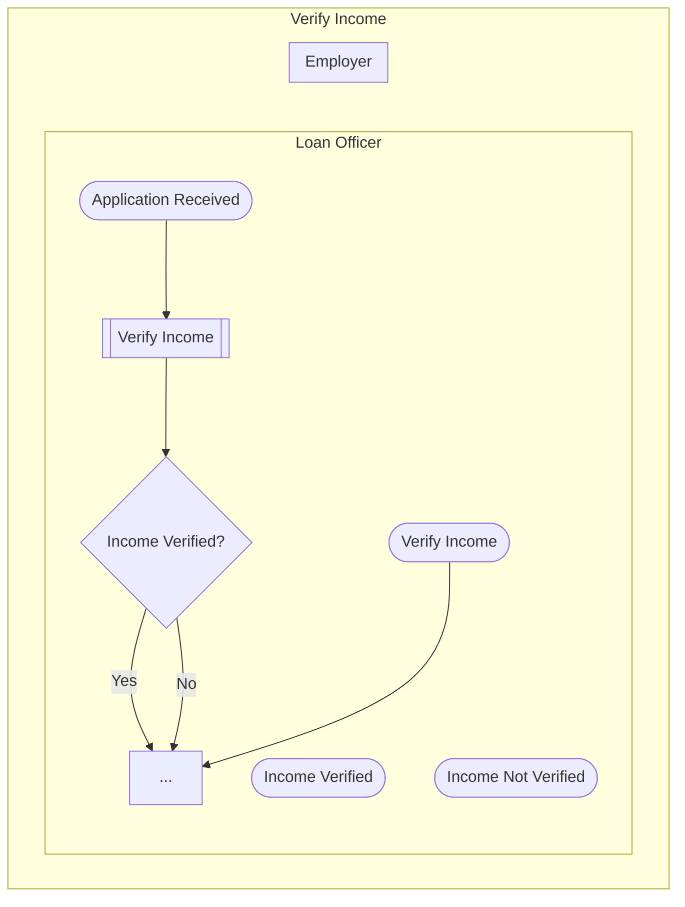

# Plan: subprocesses for flowcharts (tabs, limits, splitting by meaning)

Status: proposed. Not started.

## Problem

Large processes come out as one huge swimlane page: 40 to 60 steps across 7 or more lanes (see the samples in `plan-flow-compaction.md`). The page pans and zooms, but a reader loses the thread, and an agent reading the file gets one long flat list. The `[["..."]]` subprocess shape exists (rule 10 of `references/types/flowchart.md`) but only as a label: there is no child diagram behind it, and nested subgraphs are flattened into their top-level lane (`assets/types/flowchart/mermaid.js:97`).

## Goals

- A flowchart can hold a parent flow plus child flows, one per subprocess, in one file and one artifact.
- Limits per tab: at most **30 steps** and at most **6 lanes**. The parent and each child obey them separately.
- Subprocesses are cut by business meaning; the step count only says *when* to split, never *where*.
- An agent reading the file understands the whole flow from one `--extract` call.

## Non-goals

- More than two levels (parent plus children). A third level is out of scope until a real case needs it.
- Splitting automatically. The engine lists valid cut points; the agent picks and names them.
- Other diagram types.

## Design

### 1. Limits

- **Steps**: more than 30 steps in one tab (starts, ends and notes excluded) is a `[WARN]` naming the tab and suggesting a split by meaning (section 2).
- **Lanes**: more than 6 lanes in one tab is a `[WARN]`. The reference lists the fixes in this order:
  1. A system that only stores or is read from becomes a database shape `[("...")]` in the acting actor's lane, not a lane of its own (rule 7 already says a system is an actor only when it acts).
  2. Actors with the same role merge into one lane (rule 7, "one name per actor").
  3. The block that needs the extra lanes becomes a subprocess, so the child carries those lanes.
- A child tab shows only the lanes its steps use.
- Rule 5 (overview requests: about 7 columns, 12 nodes) stays as is and applies to the parent when the user asks for an overview.

### 2. Splitting by meaning

Add to `references/types/flowchart.md` (a new rule after rule 10, and a line in "Choosing the structure").

A block of steps becomes a subprocess when it is a unit of business meaning. Signals, strongest first:

1. **One business outcome**: the block ends in a named result (`"Credit Decided"`, `"Funds Disbursed"`, `"Claim Assessed"`).
2. **Named in the source**: a section heading, an SOP or procedure name, a `Phase N` box, a standard process name.
3. **State change of the business object** at its boundary (Application → Approved → Funded).
4. **One owning team**, even when it touches other lanes. A lane alone is not a subprocess: a lane says who, a subprocess says what.
5. **Reused**: the same work is invoked from more than one place.
6. **A cohesive exception path** (`"Handle Fraud Alert"`).
7. **A compliance or SLA unit**: audited, measured or timed as a whole.

The agent's test: can the block be named as verb + business object (rule 1), and does it end in a business outcome? If not, do not cut there.

Hard constraints (checked by `--layout`):

- One way in and one way out at the parent level: every arrow into the block reaches one entry step, and the block's outcomes leave through the parent node. This is the same shape `runOf()` already checks in the editor (`assets/types/flowchart/flowchart.js:3634`).
- No loop-back edge crosses the boundary.
- The child's end states match the labels of the parent's branches after the subprocess node (section 4).

Anti-patterns, listed in the reference: cutting at step 30 because it is step 30; a subprocess of one or two steps; a subprocess that hides a decision the parent needs to route on; one subprocess per lane.

When the parent has more than 30 steps, `--layout` also prints the valid cut candidates (single-entry, single-exit regions found by a refined process structure tree, RPST, Vanhatalo et al.), largest first: `[INFO] Subprocess candidate: verify_docs..income_ok (8 steps, 3 lanes)`. It never names or applies them; the agent decides by the signals above.

### 3. Mermaid convention

One `.mmd` file. The parent is written as today. Each child is a top-level `subgraph sub_<slug>["Name"]` holding its own `lane_` subgraphs, linked to the parent node by the slug:



- `sub_<slug>` belongs to the parent node with id `<slug>`, which must be a `[["..."]]` node. A `[["..."]]` node without a `sub_` block stays a plain subprocess label, as today (a process documented elsewhere).
- Step and note ids are unique across the whole file, so every edge reads on its own.
- **One actor, one lane id (single source of truth).** The same actor in several tabs reuses the same `lane_<slug>` inside each `sub_` block. The lane's name, icon and colour are defined once: the first `subgraph lane_x["Name"]` (or its `class` / `%% @icon` line) sets them, and a repeat may write the same name or none. A repeat with a different name is a `[WARN]` and the first name wins.
- Edges never cross a `sub_` boundary. The link between parent and child is the slug only.
- This is the one exception to "no nested subgraphs": one level, `sub_` holding `lane_`.
- Stock Mermaid renders a `sub_` block as a cluster next to the parent. That is acceptable for "Copy as Mermaid"; check it in Phase 1, including how stock Mermaid treats a `lane_` id repeated inside a `sub_` block (if it merges the clusters, "Copy as Mermaid" suffixes repeats there only; the skill's own format keeps the shared id).

### 4. Parent–child contract

- The child opens with one start pill named like the parent node (`"Verify Income"`), or like the trigger it receives.
- The child's end pills are its outcomes. When the parent node is followed by a decision, the child's ends map to its branches by name: two ends map to `Yes`/`No` of a yes/no question (`"Income Verified"` / `"Income Not Verified"` → `Income Verified?` Yes/No); three or more ends map one-to-one to named branches. One end means the parent node simply continues.
- `--layout` checks: exactly one start per child, every `sub_` has a matching `[["..."]]` node, each child has at most 30 steps and 6 lanes, end count matches the branch count of the decision that follows. A mismatch is a `[WARN]`.

### 5. Page: tabs

- A tab row above the canvas: the parent first, then one tab per child in the order the parent's flow reaches them. Tab label is the subprocess name.
- A `[["..."]]` node with a child shows a ⊞ marker; clicking it switches to that tab. A child tab has a "↑ Parent" link that returns and selects the parent node.
- Each tab keeps its own view (pan, zoom), Auto-Tidy and layout. Export and print take the current tab; "export all" writes one page per tab.
- Data: `chartData.lanes` stays the one list of actors (id, name, icon, colour) for every tab. `chartData.children = { "<slug>": { laneOrder, laneHeights, nodes, edges, notes } }` holds each child, inside the same `diagram.json`; a child refers to lanes by id and keeps only its own order and heights. The parent keeps its current shape, so a diagram without children is unchanged.
- Renaming a lane or changing its icon or colour in any tab changes it in every tab. Deleting a lane is refused while another tab still has steps in it.
- Editor: "Collapse to subprocess" on a selection moves a `runOf()`-valid run into a new child and leaves a `[["..."]]` node in its place; "Expand" does the reverse. Phase 3.
- With no children, no tab row is shown.

### 6. Reading: the whole flow from one `--extract`

`--extract` prints one Mermaid text in this order:

1. **Outline header** in `%%` comments, so the structure comes before the detail:
   ```
   %% Loan Application: 24 steps, 5 lanes, 2 subprocesses
   %% verify_income [[Verify Income]] -> sub_verify_income: 9 steps, 3 lanes, ends Income Verified | Income Not Verified
   %% assess_risk [[Assess Risk]] -> sub_assess_risk: 7 steps, 2 lanes, ends Risk Acceptable | Risk Declined
   ```
2. **The parent flow**, as today.
3. **Each `sub_` block** in the order the parent's flow reaches it, with its notes beside their steps.

Options:

- `--extract --flat`: one flow with every subprocess expanded in place (child start replaced by the incoming arrows, child ends wired to the matching parent branches), for questions like "what happens end to end" or "who touches X".
- `--extract --sub <slug>`: one child only, to keep reading a large file cheap.

`references/reading.md` gets a short section: read the outline, then the parent, then the children; `[[...]]` with a `sub_` block is a link to that block.

Round trip: `--extract` then `--layout` gives the same diagram (children included). `dev/check_extract.py` covers it.

## Phases

### Phase 1: rules and format (no page change)

- `references/types/flowchart.md`: limits (30 steps, 6 lanes per tab), the splitting rule with its signals, test and anti-patterns, the `sub_` convention, the parent–child contract, and an example.
- `mermaid.js`: parse `sub_` blocks into `children` instead of flattening them; keep the current `[INFO]` for other nested subgraphs.
- `--layout`: lay out each child with the same engine, run the checks in sections 1 and 4, print the RPST candidates above 30 steps.
- `--extract`: outline header, parent, children in flow order; `--flat`, `--sub`.
- `references/reading.md`: the reading order.
- Until Phase 2 the page shows the parent only, plus a `[INFO]` that children exist.

### Phase 2: tabs on the page

- Tab row, ⊞ marker, "↑ Parent", per-tab view and Auto-Tidy, export per tab and all tabs.
- Playground: the flowchart blank page has no children, so it only needs a republish (AGENTS.md).

### Phase 3: editor

- "Collapse to subprocess" and "Expand", built on `runOf()`.
- Undo covers both.

## Acceptance

- A 50-step sample (`laptop-v3`) rewritten as a parent plus children: every tab within 30 steps and 6 lanes, no `[WARN]`, cuts that pass the meaning test.
- `--extract` round-trips the sample; `--flat` gives the same set of steps and arrows as the original single-page version.
- `python3 dev/check_golden.py`, `python3 dev/check_extract.py`, `python3 dev/test_audit_flowchart.py`, and the browser suites `e2e_lanes`, `e2e_shapes`, `e2e_shell`, `e2e_mermaid` pass; a new `e2e_subprocess` covers tabs, ⊞, "↑ Parent" and export.
- Diagrams without `sub_` blocks are unchanged (golden diff empty).

## Open questions

- Does `--flat` keep the `[["..."]]` node as a marker around the expanded steps, or drop it? Proposed: drop it; the outline header already names the subprocesses.
