# Corporate Laptop Purchase Request Process

> **Process Identifier:** SOP-IT-PROC-042  
> **Process Owner:** Global IT Operations & Corporate Procurement  
> **Effective Date:** November 2026  
> **Status:** Active / Approved  

---

## 1. Executive Summary & Purpose

The **Corporate Laptop Purchase Request Process** governs the requisition, technical qualification, budgetary verification, procurement, hardware quality assurance, and asset handover of corporate laptop computers across the enterprise. 

This policy ensures:
1. **Asset Optimization:** Prioritizing existing inventory reassignment before acquiring new hardware.
2. **Specification Compliance:** Enforcing hardware standards aligned with role-based computing tiers while accommodating legitimate exceptions.
3. **Spend Governance:** Mandating competitive quotation tiers and management approvals commensurate with financial exposure.
4. **Fulfillment Assurance:** Providing rigorous inspection upon delivery and full post-handover support resolution.

The end-to-end workflow spans **seven organizational swimlanes** and terminates in one of **five defined end states**.

---

## 2. Swimlane Roles & Participants Matrix

| Swimlane | Participant | Primary Role & Responsibilities |
| :--- | :--- | :--- |
| **Lane 1: Employee** | Requestor | Initiates request with business requirements, addresses technical clarification requests, verifies device handover, and confirms acceptance. |
| **Lane 2: System** | Automated Workflow Engine | Enforces mandatory field completeness validation, routing triggers, and automated notification dispatches. |
| **Lane 3: IT** | IT Support & Asset Management | Assesses available internal stock, validates hardware specifications, inspects incoming vendor deliveries, and provisions standard software configurations. |
| **Lane 4: Line Manager** | Cost Centre Manager / Supervisor | Evaluates business necessity, authorizes purchase requests, and manages cost centre budget reallocations. |
| **Lane 5: Procurement** | Sourcing & Vendor Management | Obtains vendor pricing, executes competitive quote thresholds, selects preferred vendors, and issues Purchase Orders (PO). |
| **Lane 6: Finance** | Budget & Accounts Payable | Validates cost centre fund availability, commits project encumbrances, and releases purchase authorization. |
| **Lane 7: Supplier** | Authorized Hardware Vendor | Validates inventory availability, proposes equivalent substitutions when required, delivers hardware, and manages RMA defect replacements. |

---

## 3. End-to-End Swimlane Flowchart

```mermaid
flowchart TD

    %% -------------------------------------------------------------
    %% STYLING DEFINITIONS
    %% -------------------------------------------------------------
    classDef startNode fill:#1e293b,stroke:#0f172a,stroke-width:2px,color:#ffffff,font-weight:bold;
    classDef taskNode fill:#f8fafc,stroke:#64748b,stroke-width:1.5px,color:#0f172a;
    classDef decisionNode fill:#eff6ff,stroke:#3b82f6,stroke-width:2px,color:#1e3a8a,font-weight:bold;
    classDef noteNode fill:#fefce8,stroke:#eab308,stroke-width:1.5px,color:#713f12,stroke-dasharray: 4 4;
    classDef successEnd fill:#ecfdf5,stroke:#10b981,stroke-width:2px,color:#065f46,font-weight:bold;
    classDef rejectEnd fill:#fef2f2,stroke:#ef4444,stroke-width:2px,color:#991b1b,font-weight:bold;
    classDef withdrawEnd fill:#fffbeb,stroke:#f59e0b,stroke-width:2px,color:#92400e,font-weight:bold;
    classDef cancelEnd fill:#fdf4ff,stroke:#a855f7,stroke-width:2px,color:#6b21a8,font-weight:bold;

    %% -------------------------------------------------------------
    %% LANE 1: EMPLOYEE
    %% -------------------------------------------------------------
    subgraph LANE_EMP ["👤 Lane 1: Employee"]
        EMP_START(["Start: Employee Needs Laptop"]):::startNode
        EMP_SUBMIT["Submit Laptop Purchase Request"]:::taskNode
        NOTE_REQ_FIELDS["📋 Mandatory Request Fields:<br/>• Business justification<br/>• Required specification<br/>• Needed-by date<br/>• Project / cost centre"]:::noteNode
        EMP_UPDATE["Update Missing Information in Request"]:::taskNode
        EMP_NOTIF_ALLOC["Receive Device Allocation Notification"]:::taskNode
        EMP_END_ALLOC(["End 1: Laptop Allocated"]):::successEnd
        EMP_NOTIF_REJ["Receive Rejection Notification"]:::taskNode
        EMP_END_REJ(["End 2: Request Rejected"]):::rejectEnd
        EMP_PROVIDE_JUST["Provide Additional Technical Justification"]:::taskNode
        EMP_DECIDE_STD{"Accept Standard Specification?"}:::decisionNode
        EMP_ACCEPT_STD["Accept Suggested Standard Spec"]:::taskNode
        EMP_END_WITHDRAWN(["End 3: Request Withdrawn"]):::withdrawEnd
        EMP_RECEIVE["Receive Configured Laptop"]:::taskNode
        EMP_CONFIRM{"Confirm Receipt:<br/>Any Issue Found?"}:::decisionNode
        EMP_RAISE_TICKET["Raise IT Support Ticket"]:::taskNode
        EMP_CLOSE_REQ["Confirm Acceptance & Close Request"]:::taskNode
        EMP_END_ISSUED(["End 5: Laptop Successfully Issued"]):::successEnd
    end

    %% -------------------------------------------------------------
    %% LANE 2: SYSTEM (AUTOMATED VALIDATION)
    %% -------------------------------------------------------------
    subgraph LANE_SYS ["⚙️ Lane 2: System (Automated Validation)"]
        SYS_CHECK_MANDATORY{"Validate Submission:<br/>All Mandatory Fields Provided?"}:::decisionNode
        SYS_RETURN_REQ["Return Request with Validation Errors"]:::taskNode
        SYS_PASS_REQ["Forward Validated Request to IT"]:::taskNode
    end

    %% -------------------------------------------------------------
    %% LANE 3: IT (INFORMATION TECHNOLOGY)
    %% -------------------------------------------------------------
    subgraph LANE_IT ["💻 Lane 3: IT Department"]
        IT_CHECK_EXISTING{"Check Inventory:<br/>Can Existing Laptop Satisfy Request?"}:::decisionNode
        IT_RESERVE["Reserve Existing Device from Stock"]:::taskNode
        IT_NOTIFY_ALLOC["Notify Employee of Device Allocation"]:::taskNode
        IT_REVIEW_SPEC{"Review Specification:<br/>Standard or Non-Standard?"}:::decisionNode
        IT_APPROVE_SPEC["Approve Standard Specification"]:::taskNode
        IT_ASK_JUST["Request Additional Justification from Employee"]:::taskNode
        IT_REEVAL_SPEC{"Re-evaluate Non-Standard Justification:<br/>Approve or Reject?"}:::decisionNode
        IT_APPROVE_NONSTD["Approve Non-Standard Specification"]:::taskNode
        IT_SUGGEST_STD["Suggest Standard Specification Alternative"]:::taskNode
        IT_REVIEW_ALT{"Review Proposed Alternative Laptop:<br/>Accept or Reject?"}:::decisionNode
        IT_ACCEPT_ALT["Approve Alternative Laptop Model"]:::taskNode
        IT_REJECT_ALT["Reject Alternative Laptop Model"]:::taskNode
        IT_INSPECT{"Inspect Delivered Device:<br/>Damaged or Incorrect?"}:::decisionNode
        IT_RETURN_DEFECT["Return Device to Supplier with RMA / Defect Notice"]:::taskNode
        IT_CONFIGURE["Configure Laptop & Install Standard Operating Environment"]:::taskNode
        IT_ASSIGN["Assign Asset & Schedule Handover to Employee"]:::taskNode
        IT_RESOLVE_TICKET["Investigate & Resolve Reported Issue"]:::taskNode
    end

    %% -------------------------------------------------------------
    %% LANE 4: LINE MANAGER
    %% -------------------------------------------------------------
    subgraph LANE_LM ["👔 Lane 4: Line Manager"]
        LM_REVIEW_JUST{"Review Business Justification:<br/>Approve or Reject?"}:::decisionNode
        LM_NOTIFY_REJ["Notify Employee of Request Rejection"]:::taskNode
        LM_APPROVE["Approve Justification & Send to IT"]:::taskNode
        LM_BUDGET_ACTION{"Budget Unavailable Choice:<br/>Reallocate or Cancel?"}:::decisionNode
        LM_SELECT_NEW_CC["Select Alternative Project / Cost Centre"]:::taskNode
        LM_CANCEL_REQ["Cancel Purchase Request"]:::taskNode
        LM_END_CANCELLED(["End 4: Request Cancelled"]):::cancelEnd
    end

    %% -------------------------------------------------------------
    %% LANE 5: PROCUREMENT
    %% -------------------------------------------------------------
    subgraph LANE_PROC ["📦 Lane 5: Procurement"]
        PROC_OBTAIN_PRICE["Obtain Device Price & Sourcing Options"]:::taskNode
        PROC_CHECK_VALUE{"Check Total Purchase Value:<br/>Threshold Assessment"}:::decisionNode
        NOTE_PROC_THRESHOLDS["📌 Procurement Threshold Rules:<br/>• ≤ $1,500: Direct to Finance<br/>• $1,501–$5,000: 2 supplier quotes required<br/>• > $5,000: 3 quotes + budget approval"]:::noteNode
        PROC_DIRECT_FIN["Route Directly to Finance (≤ $1,500)"]:::taskNode
        PROC_OBTAIN_2QUOTES["Obtain 2 Competitive Supplier Quotes"]:::taskNode
        PROC_OBTAIN_3QUOTES["Obtain 3 Supplier Quotes & Secure Budget Approval"]:::taskNode
        PROC_SELECT_SUP["Compare Quotes & Select Preferred Supplier"]:::taskNode
        PROC_CREATE_PO["Create Purchase Order (PO) & Transmit to Supplier"]:::taskNode
        PROC_SELECT_ALT_SUP["Select Alternative Supplier & Reissue PO"]:::taskNode
    end

    %% -------------------------------------------------------------
    %% LANE 6: FINANCE
    %% -------------------------------------------------------------
    subgraph LANE_FIN ["💰 Lane 6: Finance"]
        FIN_CHECK_BUDGET{"Check Cost Centre Budget Availability"}:::decisionNode
        FIN_APPROVE["Approve Budget & Authorize Purchase"]:::taskNode
        FIN_REJECT_BUDGET["Flag Budget Unavailable & Return to Manager"]:::taskNode
    end

    %% -------------------------------------------------------------
    %% LANE 7: SUPPLIER
    %% -------------------------------------------------------------
    subgraph LANE_SUP ["🏭 Lane 7: Supplier"]
        SUP_CHECK_STOCK{"Check Inventory & Stock Availability"}:::decisionNode
        SUP_CONFIRM_DATE["Confirm Delivery Date"]:::taskNode
        SUP_PROPOSE_ALT["Propose Alternative Laptop Model"]:::taskNode
        SUP_CONFIRM_ALT_DATE["Confirm Delivery Date for Approved Alternative"]:::taskNode
        SUP_DELIVER["Ship & Deliver Laptop to IT Department"]:::taskNode
        SUP_SEND_REPLACEMENT["Process RMA & Dispatch Replacement Laptop"]:::taskNode
    end

    %% -------------------------------------------------------------
    %% WORKFLOW CONNECTIONS & EDGES
    %% -------------------------------------------------------------
    
    %% Phase 1: Submission & Automated Validation
    EMP_START --> EMP_SUBMIT
    EMP_SUBMIT -.- NOTE_REQ_FIELDS
    EMP_SUBMIT --> SYS_CHECK_MANDATORY
    SYS_CHECK_MANDATORY -->|"No: Missing info"| SYS_RETURN_REQ
    SYS_RETURN_REQ --> EMP_UPDATE
    EMP_UPDATE -.->|"Resubmit updated request"| SYS_CHECK_MANDATORY
    SYS_CHECK_MANDATORY -->|"Yes: Information complete"| SYS_PASS_REQ
    SYS_PASS_REQ --> IT_CHECK_EXISTING

    %% Phase 2: Internal Inventory Check (Fast-track)
    IT_CHECK_EXISTING -->|"Yes: Stock available"| IT_RESERVE
    IT_RESERVE --> IT_NOTIFY_ALLOC
    IT_NOTIFY_ALLOC --> EMP_NOTIF_ALLOC
    EMP_NOTIF_ALLOC --> EMP_END_ALLOC
    IT_CHECK_EXISTING -->|"No: Purchase required"| LM_REVIEW_JUST

    %% Phase 3: Line Manager Review
    LM_REVIEW_JUST -->|"Reject"| LM_NOTIFY_REJ
    LM_NOTIFY_REJ --> EMP_NOTIF_REJ
    EMP_NOTIF_REJ --> EMP_END_REJ
    LM_REVIEW_JUST -->|"Approve"| LM_APPROVE
    LM_APPROVE --> IT_REVIEW_SPEC

    %% Phase 4: IT Technical Specification Review
    IT_REVIEW_SPEC -->|"Standard spec"| IT_APPROVE_SPEC
    IT_APPROVE_SPEC --> PROC_OBTAIN_PRICE
    IT_REVIEW_SPEC -->|"Non-standard spec"| IT_ASK_JUST
    IT_ASK_JUST --> EMP_PROVIDE_JUST
    EMP_PROVIDE_JUST -.->|"Submit additional justification"| IT_REEVAL_SPEC
    IT_REEVAL_SPEC -->|"Approve non-standard"| IT_APPROVE_NONSTD
    IT_APPROVE_NONSTD --> PROC_OBTAIN_PRICE
    IT_REEVAL_SPEC -->|"Reject non-standard"| IT_SUGGEST_STD
    IT_SUGGEST_STD --> EMP_DECIDE_STD
    EMP_DECIDE_STD -->|"Accept standard"| EMP_ACCEPT_STD
    EMP_ACCEPT_STD --> PROC_OBTAIN_PRICE
    EMP_DECIDE_STD -->|"Decline standard"| EMP_END_WITHDRAWN

    %% Phase 5: Procurement Pricing & Threshold Routing
    PROC_OBTAIN_PRICE --> PROC_CHECK_VALUE
    PROC_CHECK_VALUE -.- NOTE_PROC_THRESHOLDS
    PROC_CHECK_VALUE -->|"≤ $1,500"| PROC_DIRECT_FIN
    PROC_CHECK_VALUE -->|">$1,500 and ≤ $5,000"| PROC_OBTAIN_2QUOTES
    PROC_CHECK_VALUE -->|">$5,000"| PROC_OBTAIN_3QUOTES
    PROC_OBTAIN_2QUOTES --> PROC_SELECT_SUP
    PROC_OBTAIN_3QUOTES --> PROC_SELECT_SUP
    PROC_DIRECT_FIN --> FIN_CHECK_BUDGET
    PROC_SELECT_SUP --> FIN_CHECK_BUDGET

    %% Phase 6: Finance Budget Review & Exception Handling
    FIN_CHECK_BUDGET -->|"Budget available"| FIN_APPROVE
    FIN_APPROVE --> PROC_CREATE_PO
    FIN_CHECK_BUDGET -->|"Budget unavailable"| FIN_REJECT_BUDGET
    FIN_REJECT_BUDGET --> LM_BUDGET_ACTION
    LM_BUDGET_ACTION -->|"Select another cost centre"| LM_SELECT_NEW_CC
    LM_SELECT_NEW_CC -.->|"Resubmit with new cost centre"| FIN_CHECK_BUDGET
    LM_BUDGET_ACTION -->|"Cancel request"| LM_CANCEL_REQ
    LM_CANCEL_REQ --> LM_END_CANCELLED

    %% Phase 7: Purchase Order & Stock Verification
    PROC_CREATE_PO --> SUP_CHECK_STOCK
    SUP_CHECK_STOCK -->|"In stock"| SUP_CONFIRM_DATE
    SUP_CONFIRM_DATE --> SUP_DELIVER
    SUP_CHECK_STOCK -->|"Out of stock"| SUP_PROPOSE_ALT
    SUP_PROPOSE_ALT --> IT_REVIEW_ALT
    IT_REVIEW_ALT -->|"Accept alternative"| IT_ACCEPT_ALT
    IT_ACCEPT_ALT --> SUP_CONFIRM_ALT_DATE
    SUP_CONFIRM_ALT_DATE --> SUP_DELIVER
    IT_REVIEW_ALT -->|"Reject alternative"| IT_REJECT_ALT
    IT_REJECT_ALT --> PROC_SELECT_ALT_SUP
    PROC_SELECT_ALT_SUP -.->|"Repeat stock check with next supplier"| SUP_CHECK_STOCK

    %% Phase 8: Delivery, Inspection & Configuration
    SUP_DELIVER --> IT_INSPECT
    IT_INSPECT -->|"Damaged or incorrect"| IT_RETURN_DEFECT
    IT_RETURN_DEFECT --> SUP_SEND_REPLACEMENT
    SUP_SEND_REPLACEMENT -.->|"Dispatch replacement laptop"| IT_INSPECT
    IT_INSPECT -->|"Correct & undamaged"| IT_CONFIGURE

    %% Phase 9: Assignment, Employee Confirmation & Closure
    IT_CONFIGURE --> IT_ASSIGN
    IT_ASSIGN --> EMP_RECEIVE
    EMP_RECEIVE --> EMP_CONFIRM
    EMP_CONFIRM -->|"Issue found"| EMP_RAISE_TICKET
    EMP_RAISE_TICKET --> IT_RESOLVE_TICKET
    IT_RESOLVE_TICKET -.->|"Issue resolved - verify again"| EMP_CONFIRM
    EMP_CONFIRM -->|"No issue"| EMP_CLOSE_REQ
    EMP_CLOSE_REQ --> EMP_END_ISSUED
```

---

## 4. Detailed Step-by-Step Process Specification

### Phase 1: Request Submission & Automated Validation
- **Step 1.1 (Employee):** The Employee initiates a request via the enterprise portal, providing all four mandatory attributes:
  1. *Business Justification:* Operational rationale explaining why hardware is required.
  2. *Required Specification:* Target hardware specifications (e.g., CPU, RAM, GPU, storage).
  3. *Needed-by Date:* Deadline required for project onboarding or milestone delivery.
  4. *Project / Cost Centre:* Billing code debited for hardware expenditure.
- **Step 1.2 (System):** The automated engine evaluates submission payload completeness.
  - *Branch No (Incomplete):* Request returns immediately to the Employee with highlighted error messages. The Employee remedies the deficiencies and triggers **Loopback 1** (resubmission).
  - *Branch Yes (Complete):* Request transitions to IT Asset Management.

### Phase 2: Internal Inventory Assessment (Fast-Track Allocation)
- **Step 2.1 (IT):** IT conducts a repository search across existing in-house inventory to determine if an unallocated, returned, or reconditioned laptop satisfies the operational requirements.
  - *Branch Yes (Match Found):* IT marks the asset reserved and issues an automated pickup/dispatch notification. The process reaches **End State 1: Laptop Allocated**, bypassing procurement entirely.
  - *Branch No (No Match):* Request moves to line management for formal expenditure evaluation.

### Phase 3: Line Management Business Justification Review
- **Step 3.1 (Line Manager):** The designated Line Manager evaluates the commercial validity of the business justification against departmental objectives.
  - *Branch Reject:* Manager records justification refusal. The system notifies the employee and terminates the flow at **End State 2: Request Rejected**.
  - *Branch Approve:* Manager grants endorsement, routing the ticket to IT for technical qualification.

### Phase 4: Technical Specification Review & Iterative Governance
- **Step 4.1 (IT):** IT compares requested specifications against the corporate Standard Operating Environment (SOE) catalog.
  - *Sub-path A (Standard Specification):* IT approves the standard configuration, routing immediately to Procurement.
  - *Sub-path B (Non-Standard Specification):* IT solicits in-depth engineering justification from the Employee.
- **Step 4.2 (Employee & IT):** The Employee submits specialized technical justification (e.g., virtualization overhead, heavy machine learning compute). IT re-evaluates:
  - *Re-evaluation Approve:* IT signs off on custom configuration; flow moves to Procurement.
  - *Re-evaluation Reject:* IT rejects custom hardware and offers the closest supported corporate standard configuration.
- **Step 4.3 (Employee Decision):** The Employee decides whether the recommended standard device suffices:
  - *Accept:* Employee accepts standard configuration; flow proceeds to Procurement.
  - *Decline:* Employee declines substitution; request terminates at **End State 3: Request Withdrawn**.

### Phase 5: Sourcing, Quoting & Procurement Thresholds
- **Step 5.1 (Procurement):** Procurement identifies supplier catalog pricing and assesses the total expenditure tier against enterprise governance rules:
  - *Tier 1 (≤ \$1,500):* Low-value threshold. Routed directly to Finance budget approval without requiring multi-vendor quotes.
  - *Tier 2 (\$1,501 to \$5,000):* Mid-value threshold. Procurement solicits **2 competitive supplier quotes**, evaluates terms, and nominates the preferred vendor.
  - *Tier 3 (> \$5,000):* High-value threshold. Procurement solicits **3 competitive supplier quotes** and secures formal executive budget authorization before selecting the preferred vendor.
- **Step 5.2 (Procurement):** Sourcing package and final quoted price forward to Finance.

### Phase 6: Financial Budget Verification & Cost Centre Resolution
- **Step 6.1 (Finance):** Finance audits the nominated cost centre balance against the quoted amount.
  - *Branch Approved:* Funds are encumbered, and the authorization token transfers to Procurement for PO generation.
  - *Branch Unavailable:* Finance flags insufficient funds and bounces the request back to the Line Manager.
- **Step 6.2 (Line Manager Action):** The Line Manager evaluates alternative financial remedies:
  - *Remedy A (Cost Centre Reallocation):* Manager selects an alternate project/cost centre with adequate budget and initiates **Loopback 2** back to Finance.
  - *Remedy B (Cancellation):* Manager elects not to reallocate budget, terminating the ticket at **End State 4: Request Cancelled**.

### Phase 7: Order Placement, Stock Verification & Alternative Substitution
- **Step 7.1 (Procurement & Supplier):** Procurement generates a binding Purchase Order (PO) and transmits it via EDI/Portal to the selected Supplier.
- **Step 7.2 (Supplier Stock Assessment):**
  - *In Stock:* Supplier confirms delivery date and commits logistics fulfillment.
  - *Out of Stock:* Supplier notifies Procurement and proposes a functionally equivalent alternative laptop model.
- **Step 7.3 (IT Review of Supplier Alternative):** IT reviews the proposed substitution:
  - *Accept Alternative:* IT verifies compliance; Supplier issues confirmation of amended delivery schedule.
  - *Reject Alternative:* IT rejects unsuitable model. Procurement initiates **Loopback 3**, selecting the next ranked supplier from the quote pool and reissuing a stock inquiry.

### Phase 8: Hardware Delivery, QA Inspection & Device Provisioning
- **Step 8.1 (Supplier):** Supplier dispatches the consignment to the corporate IT Depot.
- **Step 8.2 (IT Inspection):** IT inspects the physical packaging and validates hardware components:
  - *Defective / Incorrect:* Device is damaged or fails specification audit. IT issues an RMA notice to the Supplier, triggering **Loopback 4** (vendor dispatches replacement device, repeating inspection).
  - *Passed / Correct:* IT moves device to staging.
- **Step 8.3 (IT Configuration):** IT installs base corporate operating system image, security agents, mobile device management (MDM) enrollment, and role-based software packages.

### Phase 9: Assignment, User Acceptance & Post-Delivery Support
- **Step 9.1 (IT & Employee):** IT registers asset tag in the CMDB, links serial number to the employee profile, and completes physical handover or courier delivery.
- **Step 9.2 (Employee Receipt & Verification):** The Employee tests device operation:
  - *Issue Discovered:* If peripheral faults, imaging errors, or login failures are found, Employee logs a support incident. IT resolves the issue and initiates **Loopback 5** for re-verification.
  - *No Issues:* Employee signs digital acceptance; system marks asset active and closes the request at **End State 5: Laptop Successfully Issued**.

---

## 5. Terminal States Reference

The process guarantees deterministic closure across five mutually exclusive terminal states:

| Terminal Identifier | End State Label | Trigger Condition | Asset Outcome | Financial Outcome |
| :---: | :--- | :--- | :--- | :--- |
| **End 1** | **Laptop Allocated** | IT identifies viable surplus device in internal inventory. | Existing device repurposed & re-imaged. | Zero procurement spend; fast-track fulfillment. |
| **End 2** | **Request Rejected** | Line Manager determines business justification is non-viable. | No hardware issued. | Zero expenditure incurred. |
| **End 3** | **Request Withdrawn** | IT rejects non-standard spec and Employee declines standard alternative. | No hardware issued. | Requisition abandoned by requestor. |
| **End 4** | **Request Cancelled** | Cost centre lacks sufficient budget and Line Manager cannot reallocate funds. | No hardware issued. | Requisition cancelled due to budgetary constraints. |
| **End 5** | **Laptop Successfully Issued** | Device procured, provisioned, accepted by Employee without outstanding issues. | New asset registered in CMDB & deployed. | Purchase order liquidated against cost centre. |

---

## 6. Loopbacks & Retry Paths Matrix

All iterative, corrective, and remediation flows are represented via explicit dotted feedback connections (`-.->`):

| Loopback ID | Source Lane & Step | Target Lane & Step | Edge Syntax | Triggering Exception Condition | Remediation Action |
| :---: | :--- | :--- | :---: | :--- | :--- |
| **Loopback 1** | `LANE_EMP` `EMP_UPDATE` | `LANE_SYS` `SYS_CHECK_MANDATORY` | `-.->` | Submission failed validation check due to missing required fields. | Employee populates missing data points and resubmits form. |
| **Sub-flow Clarification** | `LANE_EMP` `EMP_PROVIDE_JUST` | `LANE_IT` `IT_REEVAL_SPEC` | `-.->` | IT flags hardware request as non-standard computing profile. | Employee provides technical workload calculations and engineering rationale. |
| **Loopback 2** | `LANE_LM` `LM_SELECT_NEW_CC` | `LANE_FIN` `FIN_CHECK_BUDGET` | `-.->` | Primary cost centre has insufficient capital/operational budget. | Line Manager assigns alternative project code or reallocates internal departmental funds. |
| **Loopback 3** | `LANE_PROC` `PROC_SELECT_ALT_SUP` | `LANE_SUP` `SUP_CHECK_STOCK` | `-.->` | Primary supplier is stock-constrained and proposed substitute was rejected by IT. | Procurement engages runner-up vendor from competitive bidding phase. |
| **Loopback 4** | `LANE_SUP` `SUP_SEND_REPLACEMENT` | `LANE_IT` `IT_INSPECT` | `-.->` | Physical transit damage, DOA component, or mismatched manufacturer part number. | Vendor issues return merchandise authorization (RMA) and dispatches expedited replacement unit. |
| **Loopback 5** | `LANE_IT` `IT_RESOLVE_TICKET` | `LANE_EMP` `EMP_CONFIRM` | `-.->` | Employee identifies driver conflict, software profile error, or configuration defect upon receipt. | IT service desk troubleshoots, re-images or resolves defect; Employee re-tests acceptance. |

---

## 7. Business Rules, Policies & Governance Reference

### 7.1 Mandatory Request Data Dictionary
Every submission must contain all four elements prior to downstream routing:
1. **Business Justification:** Minimum 50-word narrative outlining workload necessity, active project code, and daily computing demands.
2. **Required Specification:** Explicit CPU architecture, RAM capacity (e.g., 16GB, 32GB, 64GB), internal storage type, and display requirements.
3. **Needed-by Date:** Valid calendar date allowing standard procurement SLA (minimum 10 business days for standard models).
4. **Project / Cost Centre:** Active 8-digit General Ledger (GL) billing code verified against enterprise ERP.

### 7.2 Sourcing & Quoting Policy Matrix

| Total Value Tier | Quotation Requirement | Approval Authority | Target SLA |
| :--- | :--- | :--- | :---: |
| **Tier 1: ≤ \$1,500** | Direct catalog sourcing; single preferred vendor pricing. | Line Manager + Standard Finance | 2 Business Days |
| **Tier 2: \$1,501 – \$5,000** | Minimum 2 formal written quotes from approved suppliers. | Line Manager + Department Head + Finance | 5 Business Days |
| **Tier 3: > \$5,000** | Minimum 3 formal quotes + full technical compliance sheet. | Executive VP / Director + VP Finance | 10 Business Days |

---

## 8. Diagram Syntax & Node Accounting

- **Swimlane Subgraphs:** 7 distinct lanes (`LANE_EMP`, `LANE_SYS`, `LANE_IT`, `LANE_LM`, `LANE_PROC`, `LANE_FIN`, `LANE_SUP`).
- **Total Flow Nodes:** 60 functional nodes (1 Start node, 5 End/Terminal nodes, 13 Decision diamonds, 41 Task boxes).
- **Detail Callout Notes:** 2 note nodes (`NOTE_REQ_FIELDS`, `NOTE_PROC_THRESHOLDS`).
- **Total Edges:** 71 edges (63 forward flow links, 6 dotted feedback/loopback arrows, 2 dotted callout note links).
- **Decision Branching:** 100% of decision branches feature explicit quoted transition labels (`|"..."|`) to prevent syntax ambiguity.
