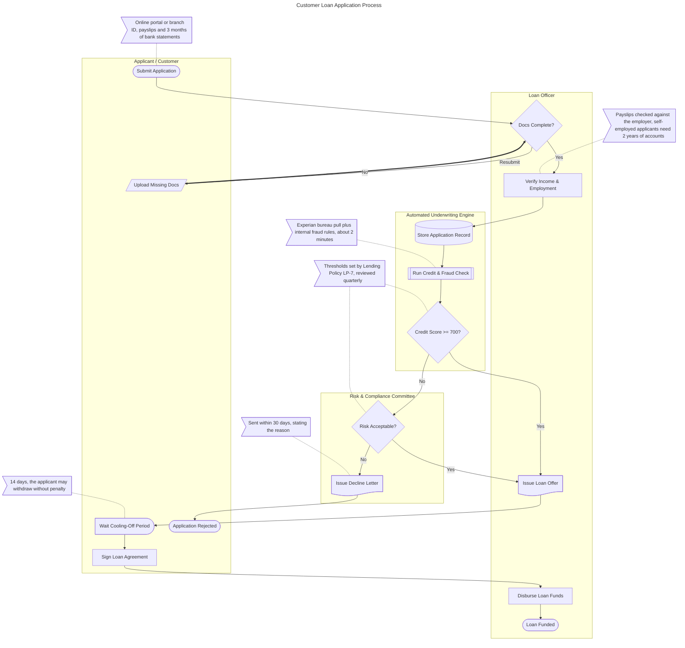

# Swimlane Flowchart (Mermaid `flowchart`)

Use for swimlane, cross-functional or BPMN-style process flows. Layout, routing, label placement and styling are computed by the tooling; author only the logical graph, as Mermaid.

## Mermaid

This is a complete diagram; no other file to read. Standard Mermaid `flowchart` syntax, plus the conventions below.

Conventions beyond standard Mermaid:

- **Header**: write a bare `flowchart`; `--layout` picks the direction. Write `flowchart TB` or `flowchart LR` only where "Choosing the structure" says to.
- **Lanes**: one top-level `subgraph lane_<slug>["Actor name"]` per lane, with its steps inside, in any order (`--layout` orders them by the flow, see below). No nested subgraphs. A diagram with one actor has no `subgraph` at all (no lane header column). Optional lane lines: `class lane_x c3` (palette slot `c1` to `c8`: only to give related lanes the same colour on purpose, never copied from the source; the theme supplies colours, and a colour the user set in the editor stays), `%% @icon lane_x user` (see Lane icons), `%% @laneOrder fixed` (keep the written lane order).
- **Steps**: ids are short slugs of the label (`validate_policy`, not `n5`) so every edge reads on its own; never `end`, `class` or `style`. Quote every label (`["Check (fast)"]`). Shapes: rule 10.
- **Start and end**: both are a pill `(["..."])`. A pill with no outgoing edge is an end; any other pill is a start.
- **Edges**: `a --> b`, `a -->|"Yes"| b`; chains and `a & b --> c` are fine. Rule 2 says when a label is needed.
- **Loop back**: draw the one edge that returns to an earlier step as `==>` (thick). Without it the engine picks the loop edge by traversal order, which may be the wrong edge of a cycle.
- **Notes**: a flag-shaped node joined to its steps by a dotted line: `n1>"Text second fact"] -.- step_a & step_b`. Never a step, never on a solid line. Rule 9 says what goes in one. ` ` separates distinct facts. `%% @showNotes` shows every note on the page instead of on hover.
- **Text**: write `;` as `#59;` and `#` as `#35;` inside labels and notes.
- Never write positions; `style`, `classDef` and `click` lines are ignored.

## Writing rules

1. **Labels name the step; notes explain it.** The label is what a reader scans to follow the flow, so it carries only the step. Everything that explains the step goes in a note (rule 9).
   - **Tasks**: an imperative verb + the business object, 2–4 words, Title Case (`"Validate Order"`, `"Approve Loan"`), never a sentence (`"The order needs to be validated"`).
   - **Specific verbs**: not `"Process"`, `"Handle"`, `"Manage"` or `"Do"`; name the action (`"Handle Claim"` → `"Assess Claim"`).
   - **Leave out** articles and pronouns, the actor (the lane says who; phase lanes are the exception, rule 7), the element type (`"Decision:"`, `"Task:"`), step numbers, and every detail rule 9 puts in a note. The one exception is the condition a decision tests, which is its question (`"Credit Score >= 700?"`).
   - **Start** names the trigger, as an event (`"Order Received"`) or the first action (`"Submit Application"`); **end** names the resulting state (`"Loan Approved"`, `"Claim Settled"`), one per outcome (rule 6).
   - **Distinct names**: no two steps share a label. If the same work really happens twice, loop back to it with an edge instead of repeating the node.
   - **A check is its decision**: a check, review, validation, verification, inspection or assessment whose only result is the answer to the next decision *is* that decision (`"Laptop in Stock?"`, never `"Check Stock"` → `"Laptop in Stock?"`). It sits in the checker's lane, and a loop that returned to the check returns to the decision. Keep a separate step only when it also produces something else (a record, a report, a configured device) or is a subprocess.
2. **Decisions end in `?`** (`"Docs Complete?"`) and every outgoing branch is labeled. A two-way decision is a yes/no question with `Yes`/`No` branches (`"Justification Approved?"`, not Approve/Reject), whatever words the sources use for the outcomes. Use named outcomes only for three or more branches, one edge per outcome (`"Purchase Value Band?"` → `"<= $1,500"`, `"$1,501–$5,000"`, `"> $5,000"`). Never mix the two styles on one decision, and never chain Yes/No diamonds to split one question. Keep sequential guard checks separate only when each failure routes to a different owner or end state; when several criteria combine into one outcome (such as a scoring matrix or tiered policy), evaluate them in one task and put the decision table in its note. Numeric branches keep the sources' exact boundaries and never overlap. Only decision branches get `Yes`/`No` labels: an edge leaving a step has no label.
   - **Parallel work (`AND`) vs decisions (`XOR`)**: a decision takes one outgoing branch. For steps that run concurrently, draw several unlabelled edges out of the preceding task (never a decision or an invented fork/join shape) and merge them into one join task, with a note stating that all parallel branches must complete before continuing.
3. **One owner per node**: place each node in the lane of the actor who performs it.
4. **Keep labels short, counted in words**: at most **5 words** for any step or decision (tasks are usually 2–4, rule 1). A longer label is cut with `...` and shows on hover, but an exported or printed diagram has no hover.
   - **Lane names**: at most 4 words (about 32 characters), so the floating pill never truncates.
   - **Fidelity**: keep the user's wording when it fits 5 words and rule 1. Otherwise cut the label to its verb + object; if the cut removed real detail (rule 9's list), put only that detail in a note, never the whole original sentence. Never abbreviate words (`"Auth"`) to save space.
5. **Overview requests**: if the user asks for a summary, high-level overview or one-slide flow, aim for about 7 columns and 12 nodes so it fits a 1080p screen without panning. Otherwise include every step the source has; the page pans and zooms.
6. **Exceptions end in their own end state.** A path that finishes unresolved (manual intervention, escalation, an unhandled fallback) ends in a separate end node named for that outcome (`"Manual Payment Required"`), never merged into the success end (`"Claim Settled"`). Creating a task for someone else is not completion. If a failure path must undo earlier work (such as releasing reserved stock or reversing a charge), include the compensating step before that failure end node.
   - **Approvals are decisions.** An approval, sign-off or authorisation is a decision node (`"Budget Approved?"`) with both outcomes, even when the source names only the approval; a plain review or check with no stated failure outcome stays a task. An unstated rejection ends in its own state (`"Request Rejected"`): report that end state as an assumption, but not the decision itself (this rule chose it).
   - **Timeouts, escalations and retries**: model an SLA timeout or retry limit as an explicit decision (`"Approved in 48h?"`, `"Retries < 3?"`) rather than hiding the transition inside a note; use a delay shape only for an unconditional wait along a path.
7. **One lane per actor.** A lane is who does the work: a role, team, organisation or system that performs steps.
   - Name lanes as actor nouns (`"Loan Officer"`, `"Customer"`, `"Payment Gateway"`), never an activity (`"Review"`), a status (`"Pending"`) or a category (`"Manual Tasks"`). Prefer roles to people's names.
   - **One name per actor**: when sources name one actor differently (`"IT Support"`, `"IT Department"`), use the name the sources use most often (on a tie, the shortest) and report the choice as an assumption.
   - A system is an actor only when it acts (`"Core Banking"` validating something). Don't add a lane for a system that is only mentioned.
   - If the source doesn't name actors, infer them from who performs each verb. If you can't, or the whole process has one actor, write no `subgraph`. Never use a generic lane such as `"Process"`, `"Steps"` or `"Other"`.
   - **Exception, phase lanes**: if the source groups steps into sequential containers (step, phase, stage, milestone, sprint, gate, quarter) and every step in one group happens after every step in the previous one, use one lane per container, in order (`lane_step1`, ...) (`flowchart TB`, `subgraph lane_step1["Step 1: Request"]`, ...); otherwise use actor lanes. If the source shows both, follow whichever it groups by visually. Phase lanes drop ownership, so only here keep the actor in a label where it matters (`"Officer Reviews Docs"`). A jump back to an earlier phase is a loop-back edge.
8. **Lane icons are automatic**: `--layout` picks a different icon for each lane from its name and reports it as one `[INFO] Lane icons: ...` line. To choose one, write `%% @icon lane_x <name>` (names under Lane icons; an unknown name is a `[WARN]`). For phase lanes, icons that suit each stage (`clipboard`, `check`, `shield`, `flag`, ...) read best.
9. **Notes hold what the label leaves out.** Add a note only where the source gives a detail from the list below that the label lacks; most steps need none. A longer sentence saying the same thing as the label is not a note: drop it.
   - **In a note**: how or why the step is done (method, criteria), business rules and thresholds, amounts, SLAs, durations and schedules, the system or tool used, documents and forms, policy, regulation or ticket references, and examples. Keep the source's figures, names and IDs exactly.
   - **Never in a note**: flow. A step, branch, loop, hand-off or outcome that changes what happens next is a node or an edge, so a reader who never opens a note still sees the whole process. A note may add detail to a step but is never the only place a step appears. Never repeat the label. Test: if deleting the note would change what a reader thinks happens next, it is flow.
   - **Form**: a fragment or one or two short sentences, facts over prose, at most 140 characters; ` ` separates distinct facts.
   - **`%% @showNotes`**: leave it out by default (notes open on hover). Write it when the reader needs the notes without interacting: the diagram is meant for export, print or a presentation, or the user asks for the detail to be visible.
   - **One note, several steps**: when the same fact explains several steps (one policy behind two decisions, one system doing three steps), write one note joined to every step (`-.- a & b`), never copies of it.
10. **Classic symbols by the step's object**: use the shape whose row matches the step. Anything else is a plain task `["..."]`, including every step where the actor decides, writes content or does physical work, and every step you are unsure about. Each is a step in the sequence (arrows in and out), never a side box off the flow, with a task's size and colours. Labels stay verb + object (rule 1).

| Write as | Use when the step |
|---|---|
| `id[["..."]]` subprocess | is a process documented elsewhere (`"Run Onboarding Process"`) |
| `id[/"..."/]` io | only transfers a form, file or data between parties: upload, submit, send, receive (`"Upload Missing Docs"`) |
| `id@{ shape: doc, label: "..." }` document | produces a named document for someone else: letter, purchase order, invoice, contract, report (`"Issue Decline Letter"`) |
| `id[("...")]` database | reads or writes a named system of record: ERP, CRM, asset register (`"Store Claim Record"`) |
| `id@{ shape: delay, label: "..." }` delay | is a wait: cooling-off, SLA timer, batch window (`"Wait for Payment Run"`) |

Other Mermaid shapes (hexagon, trapezoid, ...) are read as a task with an `[INFO]`.

11. **Plain arrows only; never write a connector** (`id(("A"))`). `--layout` splits a long, tangled arrow into a lettered connector pair itself and prints `[INFO] Added connector pair A: <from> -> <to>`, or `[INFO] Layout: Long arrow ...` for one it leaves. Report those lines; do not edit the Mermaid for them. If the source draws connectors, write the arrow they stand for.

## Choosing the structure

Decide from the source, once, first match first (rule 7 has the details). Do not trial the alternatives.

- Sequential boxes titled `Step N` / `Phase N` / `Stage N`: one lane per container, in order; `flowchart TB` if they stack downwards.
- Several actors or systems handing work over: one lane per actor. One actor, one sequence: no `subgraph`.
- Write a direction only for phase lanes as above, or when the user names one ("vertical" is `TB`, "left to right" is `LR`); otherwise a bare `flowchart`.
- Write lanes in any order: `--layout` orders them by the flow (not phase lanes) and prints `[INFO] Lane order: ...`; report it.

**Updating an existing flowchart**: a re-layout resets lane heights and keeps lane order, lane membership and loop-back edges; a note the user dragged keeps its place beside its step. With Auto layout on (the default) the page already re-lays out after every step edit, so hand-placed positions exist only where the user switched Auto off.

## Lane icons

Optional (rule 8). Names: `user`, `users`, `briefcase`, `building`, `headset`, `monitor`, `code`, `server`, `database`, `cloud`, `cpu`, `cog`, `shield`, `scale`, `banknote`, `credit-card`, `mail`, `package`, `truck`, `cart`, `clipboard`, `check`, `layers`, `globe`, `flag`.
