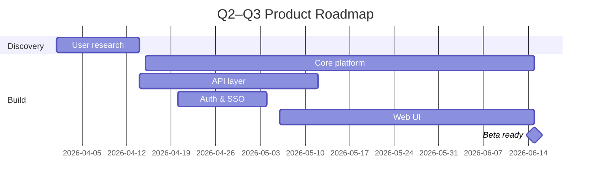

# Gantt / Roadmap Timeline (Mermaid `gantt`)

Use for high-level project roadmaps, release schedules, and multi-phase timelines with real calendar dates, nested tasks, dependencies, and milestones. Not for process logic with decisions (use `flowchart`) or time-ordered service calls (use `sequence`). Timeline geometry, parent rollups, weekend/holiday bands, and orthogonal dependency arrows are computed by the tooling; author only the logical model as Mermaid.

## Mermaid

This is a complete diagram; no other file to read. Standard Mermaid `gantt` syntax, plus the `%% @...` directives below.

Syntax and `%% @...` directives:

- **Header**: `gantt`, `title <text>`, `dateFormat YYYY-MM-DD` (default), and optional `excludes YYYY-MM-DD, ...` for manual off-days.
- **Sections**: `section <Name>` creates a top-level parent group (`kind: "group"`). Subsequent tasks belong to it unless reassigned with `%% @parent`.
- **Tasks & row milestones**: `Label :[tags,] [id,] <start | after id>, <end | duration>` (durations accept `Nd` or `Nw`, e.g. `14d`, `2w`). Tag `milestone` creates a row milestone diamond on a single date (`0d`).
- **`%% @zoom <day|week|month|quarter|year>`**: initial time-scale preset (default `month`). Zoom changes horizontal density while keeping text crisp.
- **`%% @holidays <auto|none|CC[,CC...]>`**: public holiday mode. `auto` (default during CLI generation) detects the local timezone's country, fetches public holidays for the chart's year span, caches them locally, embeds them into the HTML, and falls back silently when offline. Use ISO-3166-1 alpha-2 codes (e.g. `VN,US`) for specific countries, or `none` to disable auto-fetch.
- **`%% @holiday <YYYY-MM-DD[..YYYY-MM-DD]> <Label>`**: explicit or cached holiday entry (single day or inclusive range). Survives `--extract`.
- **`%% @colorKey <slot>: <Label>, ...`**: names palette slots `1`–`9` in the Color Key legend.
- **`%% @marker <Label> : <YYYY-MM-DD> [color]`**: chart-wide vertical milestone line (e.g. "Launch Day") with optional palette slot `1`–`9` or `#hex`.
- **`%% @parent <id> <parentId>`**: nests any task or row milestone under another task or group to unlimited depth. Parent bars automatically roll up from earliest child start to latest child end.
- **`%% @dep <toId> <fs|ss|finish-start|start-start> <fromId>`**: explicit dependency arrow. `after <id>` on a task line also creates an `fs` dependency. Finish-to-Start (`fs`) connects `from` end to `to` start; Start-to-Start (`ss`) connects `from` start to `to` start.
- **`%% @color <id> <1..9|#hex>`**: bar or milestone palette colour.
- **`%% @collapsed <id>`**: opens a parent row collapsed.
- **`%% @note <id> <text>`**: attaches one note to a task or row milestone (use `\n` for line breaks).

## Writing rules

1. **Keep labels concise**: aim for **3–6 words** per task or milestone label so bars stay scannable at every zoom level. Put scope details, owners, risks, or assumptions in `%% @note` instead.
2. **Use real `YYYY-MM-DD` dates**: every leaf task and milestone needs valid dates with `end >= start`. Parent tasks with children roll up automatically from their children, so keep parent dates consistent or let children define the span.
3. **Nest with `%% @parent` for hierarchy**: use `section` for top-level phases and `%% @parent <child> <parent>` for subtasks (unlimited depth). Give every referenced item a short, unique lowercase `id` (never duplicate IDs or create parent cycles).
4. **Model dependencies cleanly (`FS` and `SS` only)**: use `after <id>` or `%% @dep <to> fs <from>` for sequential handoffs, and `%% @dep <to> ss <from>` for parallel kickoffs. The chart never auto-pushes dates—intentional overlaps are allowed and shown with a subtle warning tint on the arrow. Never create self-loops or dependency cycles.
5. **Choose the right milestone form**: use a row milestone (`:milestone, ...`) for deliverable gates tied to a phase or dependency chain; use `%% @marker` for chart-wide events (code freeze, launch day) that span all rows.
6. **Colour by category, not per task**: use `%% @colorKey` with at most **3–5 categories** (such as workstream or team) and apply `%% @color` consistently. Leave uncategorized items on the default colour.
7. **Pick a fitting initial zoom**: set `%% @zoom` to match the roadmap span (`day`/`week` for 2–8 week sprints, `month` for 1–3 quarters, `quarter`/`year` for multi-year plans).
8. **Holidays**: omit `%% @holidays` (or set `auto`) for normal roadmaps so generation embeds local public holidays automatically with zero extra tokens. Use `%% @holidays none` (optionally with explicit `%% @holiday` lines) when you need a 100% deterministic offline output.
