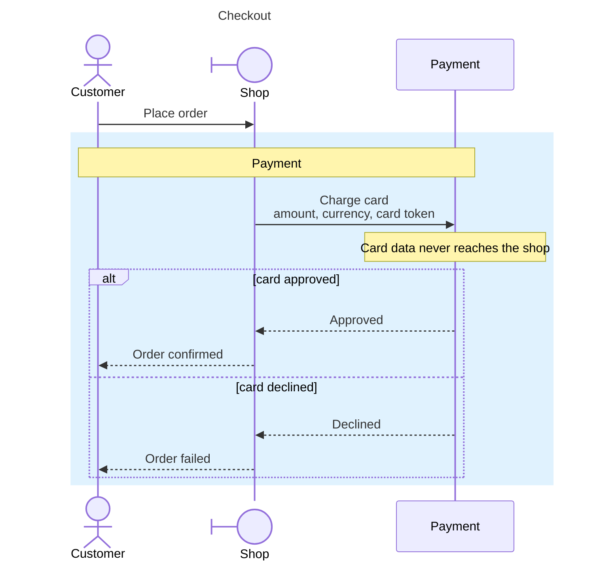

# Sequence Diagram (Mermaid `sequenceDiagram`)

Use for messages exchanged between participants over time: API calls, system integrations, user-to-system interactions. Not for process flows with decisions and ownership (use `flowchart`). Positions, participant order, spacing, activation bars and frame boxes are computed by the tooling; author only the logical model, as Mermaid.

## Mermaid

This is a complete diagram; no other file to read. Standard Mermaid `sequenceDiagram` syntax, plus the conventions below.

Conventions beyond standard Mermaid:

- **Participants** are listed in the order you declare them (`--layout` reorders them unless `%% @participantOrder fixed`). Kind: `actor x as Name` (person); `participant x@{ "type": "database" } as Name` (`database`, `queue`; `boundary` is a screen or front end, `ui`); a plain `participant` is a back-end service or app; for a third-party system write `%% @kind psp external` after its declaration. Ids are short and never a Mermaid keyword.
- **Messages**: `->>` call, `-->>` reply (dashed return), `-)` async. Write one line of parameters or payload after the label as `Label detail` (the first ` ` splits them; no more line breaks). `%% @showDetails false` hides detail lines (shown on hover instead). A message to the same participant is a self-message.
- **Activation bars** are computed from calls and replies; do not write `+`, `-`, `activate` or `deactivate`. To override one, put `%% @activate false` (no bar) or `%% @until 12` (hold the bar open until step 12) on the line before the message.
- **Lifelines**: `create participant x as Name` on the line before the message that starts it, and `destroy x` on the line before the message that ends it (Mermaid's own syntax), only where the source says a participant starts later or ends earlier than its own messages.
- **Frames**: `opt`, `alt` (`else`), `loop`, `par` (`and`), nested at most three deep, always with the guard in the label. `%% @color 3` on the line before a frame tints it (slot 1 to 8, or 9 for grey).
- **Phase** (a named group of messages): `rect rgb(...)` around its messages, with its name as the first line inside, a note over the first and last participant: `Note over customer,pay: Payment`. `rect transparent` for a phase with no colour.
- **Notes**: `Note over A: text` or `Note over A,B: text` (one or two participants; ` ` for a line break). A note sits below the message above it, or above the next message when it follows a frame opening, `else`, `and` or `end`.
- **Participant colours**: `box Aqua Our services` ... `end` around contiguous participants; the label names the colour in the legend. `%% @color 1` on the line before the `box` picks the palette slot (1 to 8); otherwise the nearest one is used.
- **Numbers**: `autonumber` shows step numbers; leave it out, `--layout` turns it on at 20+ messages.
- **Text**: write `;` as `#59;` and `#` as `#35;` in messages and notes.

## Writing rules

1. **Participants are lifelines, not steps**: name them as the party (`Payment Service`), not the action. Give each the kind that matches its role. Keep `database` interactions at domain-operation level (`Reserve stock`, `Record order`), never raw SQL (`SELECT * FROM ...`).
2. **Keep text concise (soft word limits)**: aim for at most **3–4 words** on a participant name, at most **6 words** on a message label (`Charge card`, `Order confirmed`), and at most **8 words** on a detail (one line). Short text keeps columns compact and Fit zoom legible.
3. **Pair calls with replies**, so activation bars and flow read cleanly; use `-)` async for fire-and-forget events (routing through a `queue` participant where applicable). Use self-messages only for nontrivial internal logic (idempotency check, signature verification, state validation); omit trivial internal steps.
4. **Frames wrap whole messages only**. `alt` for either/or, `opt` for optional, `loop` for repetition, `par` for parallel. Always write explicit guard conditions for `opt`, `loop` (including iteration or retry bounds, such as `for each item` or `up to 3 retries until 2xx`), `alt` and `par`.
5. **Put the happy path first in `alt`** and keep each branch's terminal outcome or error reply inside the `alt` (never leave a success reply outside an `alt` that also has a failure branch). Multiple outcomes or parallel tracks use one `alt` or `par` with several `else` / `and` branches, never nested `alt`s.
6. **Every note, rule, state or SLA in the source is a `Note over`** the participant it concerns (or two, stretched between them), placed at its position in time order.
7. **Colour only to match source grouping**: leave colours out by default. Colour a phase only when the source colours or names it (one colour per phase); colour participants only when the source groups them by ownership or domain (at most 4 colours total, never one per participant).
8. **Wrap natural phases in `rect` blocks**: when a flow has distinct phases, wrap each phase around all its messages (leaving no loose messages outside a phase) so Focus/collapse works interactively in the page.
9. **Overview requests**: if the user asks for a summary or one-slide view, keep it concise to the key phases and handoffs. Otherwise include every message, branch and note from the source; the page pans, zooms, pins participant headers and collapses phases.
