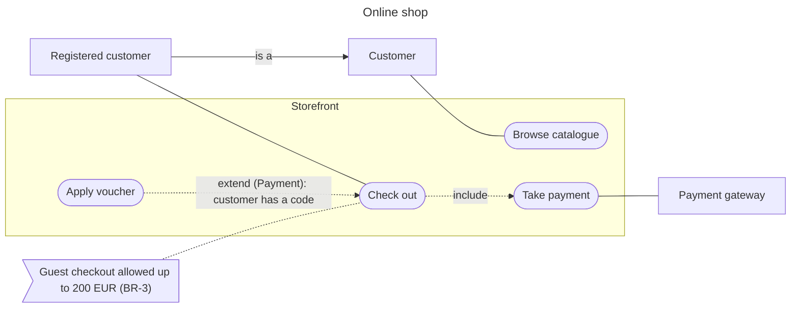

# Use Case Diagram (Mermaid `flowchart` with `%% @type usecase`)

Use for what a system does for the people and systems around it: who (actors) wants what (use cases, as goals) from which system (the subject, drawn as the boundary). Not for the order of steps (use `flowchart` or `sequence`) and not for data (use `erd`): a use case diagram has no sequence, no data and no internal steps. Positions, box sizes and the lines are computed by the tooling; author only the logical model, as Mermaid, and colour the use cases by feature area (see Colour).

## Mermaid

Mermaid has no use case diagram, so this is a `flowchart` marked by the line `%% @type usecase`. This is a complete diagram; no other file to read.

Conventions beyond standard Mermaid:

- **Subject**: one `subgraph id["System name"]` per system boundary, top to bottom. **Inside a subgraph is a use case, outside is an actor.** With no subgraph at all (one unnamed boundary titled with `title`), a stadium `([ ])` or ellipse `(( ))` node is a use case and anything else an actor.
- **Actor**: `id["Role"]`, 3 words at most, never a person's name. `:::system` marks an external system and `:::time` a scheduled trigger (both drawn with `«system»` / `«time»`; default is a person). `class x abstract` draws the name in italics and exempts the actor from the "no association" warning. Colours are given to actors automatically: leave them out unless the user asks for one.
- **Use case**: `id(["Verb object"])`, 5 words at most, wraps to two lines. `:::subfunction` draws it smaller with a dashed outline. `class x abstract` for an italic name. A node takes one `:::` only, so more classes go on `class x name` lines (one id may have several). Never write `:::summary`.
- **Colour**: `:::c1` to `:::c8` (a palette slot, the feature area) and `%% @colorKey 1 Ordering` naming each slot (shown as a legend). Write a `colorKey` whenever you colour.
- **Association**: `actor --- usecase` (`-->` is the same; direction means nothing). Put the actor that starts the use case first, a supporting actor last (`usecase --- psp`): primary actors are drawn on the left, supporting actors on the right. `%% @navigable actor usecase` draws an open arrowhead toward the use case.
- **Include**: `base -.->|include| used`, from the base to the included use case. **Extend**: `ext -.->|"extend (Payment): customer has a code"| base`, from the extension to the base; the condition (6 words at most) follows the colon, and the extension point in parentheses is optional (`"extend: customer has a code"`).
- **Generalization**: `child -->|is a| parent`, between two actors or two use cases (a specialised actor, or variants of one goal).
- **Requirements**: `%% @refs checkout FR-4, FR-5` (ids of 12 characters at most, searchable in the page; `%% @showRefs` shows them as chips under the name) and `%% @points checkout Payment, Shipping` (extension points: the base's compartment, named by `extend (Payment)`).
- **Notes**: a flag node joined by a dotted line to the actors or use cases it concerns: `n1>"Text"] -.- checkout & customer` (120 characters at most). `%% @showNotes` draws notes on the canvas instead of as badges.
- **Ids** are short and lower case (`checkout`, `psp`), unique across actors, use cases and subjects, and never `end`, `class` or `style`. Quote every label. Write `;` as `#59;` and `#` as `#35;` in text.

## Writing rules

Trace the requirements in this order before writing the Mermaid.

1. **Fix the subject (scope).** Name the system under design: one boundary per system. A requirement set that covers two systems (a storefront and a back office) gets two subgraphs. Anything outside every boundary is an actor.
2. **Find the actors.** For each requirement ask who starts it and who else takes part. Actors are roles ("Customer", not "Alice"). Primary actors start a use case (drawn left). Supporting actors are roles or external systems the subject calls, such as a payment gateway or a mail service (`:::system`, drawn right). A scheduled trigger ("Nightly", "End of month") is a `:::time` actor. The database, the UI and the subject's own modules are never actors.
3. **List the goals.** For each primary actor list every goal the requirements give it at **user-goal level**: one actor, one sitting, a result worth walking away with ("Place order", "Refund payment"). Name each **verb + object** in the actor's words. UI mechanics ("Enter password", "Click submit") are never use cases. Lower-level utility goals ("Log in", "Validate card") are not use cases unless several use cases share them (rule 5), in which case mark them `:::subfunction`; higher-level overview goals ("Manage store") are kept at user level only when asked.
4. **Connect.** One association per actor and use case it takes part in.
5. **Factor, only where the requirements show it.** Ask: *does it always happen?* `include`. *Only sometimes?* `extend`.
   - `include`: behaviour two or more use cases **always** need ("Authenticate", "Calculate tax"). Never use `include` to chain steps in order.
   - `extend`: optional or conditional behaviour added to a base ("Apply voucher" extends "Check out" when the customer has a code). Keep the base use case complete without its extensions; do not explode routine validation errors ("Invalid password") into `extend` ovals: put error handling and minor variations in a note (or model them in a `flowchart`/`sequence`). Always write the condition; add the extension point (and matching `%% @points` on the base) when the base has multiple insertion points or the source names one, and omit it on a single self-evident extension to keep the oval compact.
   - Generalization (`is a`): a specialised actor (Registered customer → Customer), or variants of one goal (Pay by card → Pay). Use sparingly.
6. **Trace.** Every functional requirement maps to at least one use case: put its id in `%% @refs`. Every business rule, threshold, SLA or non-functional requirement that concerns a use case becomes a note on it. Nothing is dropped; nothing is invented.
7. **Check.** Each actor has an association; each use case is reached by an actor (directly, or through `include`, `extend` or `is a`); no CRUD explosion (four use cases "Create/Read/Update/Delete X" become "Manage X" unless different actors, permissions, or distinct workflows/SLAs apply, such as keeping "Place order" and "Cancel order" separate when their rules differ); no `include` cycles; no actor inside a boundary.

Also:

- **Never leave a use case out or collapse a subject to save space**; the page pans, zooms, collapses and searches by itself.
- **Do not model a flow.** If the requirements describe an order of steps, that is a `flowchart` or `sequence`; a use case diagram only names the goals.

## Colour

Colour is the reader's first grouping cue. For more than 8 use cases:

1. Group the use cases by the requirement document's sections or headings (feature areas: Ordering, Payments, Fulfilment), using the source's own words.
2. Give each area one slot from `c1` to `c8` (at most 8 areas), put every use case of that area in it, and name each in `%% @colorKey`.
3. Leave actors and subjects neutral: placement already says primary or supporting, and a boundary is a frame, not a category.

A diagram of 8 or fewer use cases may stay neutral. The audit warns when a diagram has more than 12 use cases and none has a colour.
